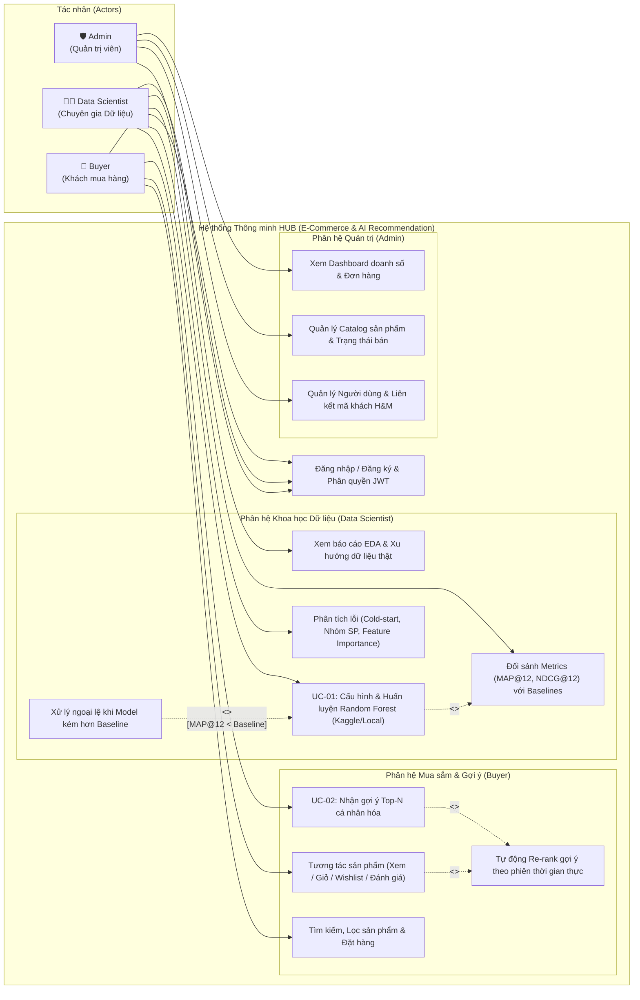
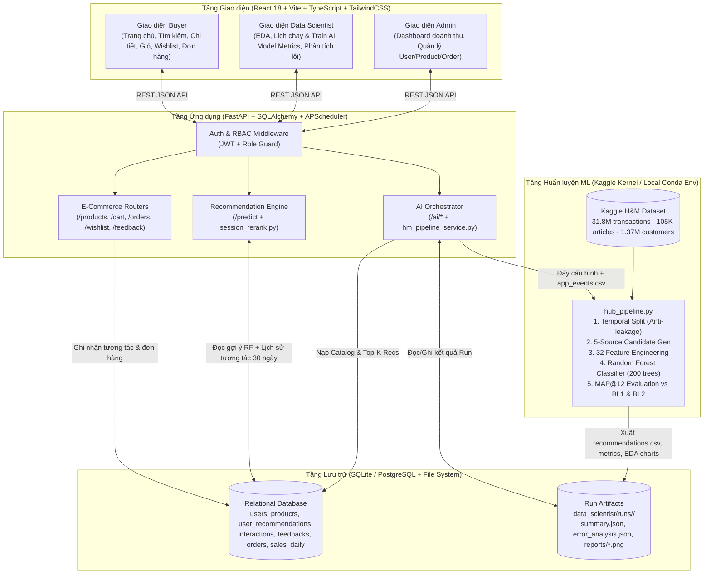
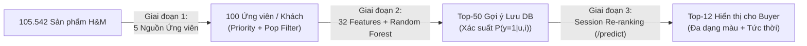

# BÁO CÁO ĐỒ ÁN MÔN HỆ THỐNG THÔNG MINH (INTELLIGENT SYSTEMS — CO5119)

**Tên đề tài:** **HUB — Hệ thống Thương mại Điện tử & Gợi ý Thời trang Cá nhân hóa sử dụng Random Forest Ranker**  
**Thuật toán chính:** Two-Stage Recommendation (Heuristic Candidate Generation + Random Forest Pointwise Ranker + Real-time Session Re-ranking)  
**Nguồn dữ liệu thực tế:** [H&M Personalized Fashion Recommendations (Kaggle Competition)](https://www.kaggle.com/competitions/h-and-m-personalized-fashion-recommendations/data) — 31.788.324 giao dịch thực tế, 105.542 sản phẩm, 1.371.980 khách hàng.

---

## Mục lục
1. [Tổng quan Bài toán & Mục tiêu (Problem Definition & Objectives)](#1-tổng-quan-bài-toán--mục-tiêu)
2. [Các Bên Liên quan, Tác nhân & Yêu cầu Hệ thống (Stakeholders, Actors & Requirements)](#2-các-bên-liên-quan-tác-nhân--yêu-cầu-hệ-thống)
3. [Phân tích & Thiết kế Hệ thống (System Analysis & Design)](#3-phân-tích--thiết-kế-hệ-thống)
4. [Nguồn Dữ liệu, Phân tích Khám phá (EDA) & Tiền xử lý (Data Source, EDA & Preprocessing)](#4-nguồn-dữ-liệu-phân-tích-khám-phá-eda--tiền-xử-lý)
5. [Chia Dữ liệu Theo Thời gian & Chống Rò rỉ Dữ liệu (Temporal Split & Leakage Prevention)](#5-chia-dữ-liệu-theo-thời-gian--chống-rò-rỉ-dữ-liệu)
6. [Thuật toán Gợi ý & Quy trình Huấn luyện (Algorithm & ML Workflow)](#6-thuật-toán-gợi-ý--quy-trình-huấn-luyện)
7. [Kết quả Thực nghiệm, So sánh Baseline & Phân tích Lỗi (Evaluation & Error Analysis)](#7-kết-quả-thực-nghiệm-so-sánh-baseline--phân-tích-lỗi)
8. [Tích hợp Hệ thống, Kiểm thử & Xử lý Đầu vào (System Integration & Testing)](#8-tích-hợp-hệ-thống-kiểm-thử--xử-lý-đầu-vào)
9. [Giới hạn & Hướng Phát triển (Limitations & Future Work)](#9-giới-hạn--hướng-phát-triển)
10. [Đóng góp Thành viên & Tuyên bố Sử dụng Generative AI (Team Contribution & AI Disclosure)](#10-đóng-góp-thành-viên--tuyên-bố-sử-dụng-generative-ai)

---

## 1. Tổng quan Bài toán & Mục tiêu

### 1.1. Phát biểu bài toán (Problem Statement)
Trong thương mại điện tử ngành hàng thời trang (Fast Fashion), danh mục sản phẩm có quy mô rất lớn (hơn $105.000$ mã sản phẩm tại H&M) và vòng đời xu hướng thay đổi liên tục theo mùa và theo tuần. Khách hàng đối mặt với tình trạng quá tải thông tin (*information overload*) khi tìm kiếm sản phẩm phù hợp với sở thích, độ tuổi và lịch sử mua sắm của mình.

Bài toán đặt ra cho hệ thống **HUB** là:
> **Cho trước lịch sử giao dịch mua hàng thực tế, thông tin nhân khẩu học của khách hàng và thuộc tính danh mục sản phẩm tính đến thời điểm $T$, hãy dự đoán danh sách có thứ tự gồm $K = 12$ sản phẩm ($\text{Top-12}$) mà mỗi khách hàng có khả năng mua cao nhất trong 7 ngày kế tiếp $[T, T + 7\text{ ngày})$, đồng thời điều chỉnh danh sách này tức thời theo hành vi tương tác của khách hàng ngay trong phiên duyệt web.**

### 1.2. Mục tiêu và Phạm vi hệ thống (Objectives & Scope)
- **Xây dựng quy trình Học máy (ML Pipeline) hoàn chỉnh trên dữ liệu thật 100%:** Tuyệt đối không sử dụng dữ liệu giả lập (*no simulated data*). Toàn bộ quá trình huấn luyện, kiểm định và đánh giá sử dụng bộ dữ liệu lịch sử thực tế của H&M từ Kaggle.
- **Giải quyết bài toán Extreme Class Imbalance & Scale:** Với $1,37$ triệu khách hàng và $105.542$ sản phẩm, không gian tích Đề-các lên tới $\sim 1,45 \times 10^{11}$ cặp `(customer, article)`. Hệ thống áp dụng kiến trúc 2 giai đoạn (*Candidate Generation + Random Forest Ranker*) kết hợp lấy mẫu âm (*negative downsampling*) để huấn luyện hiệu quả.
- **Tích hợp thuật toán vào hệ thống MVP thực tế (End-to-End Integration):** Mô hình không nằm rời rạc trong notebook mà được điều phối trực tiếp từ giao diện quản trị của **Data Scientist**, lưu kết quả vào cơ sở dữ liệu quan hệ, và kết hợp với tầng **Session Re-ranking** tại Backend API để phục vụ **Buyer** với độ trễ thấp ($< 100\text{ ms}$).

---

## 2. Các Bên Liên quan, Tác nhân & Yêu cầu Hệ thống

### 2.1. Stakeholders & Actors
Hệ thống được thiết kế xoay quanh 3 tác nhân (Actors) chính có phân quyền độc lập bằng JWT và Role-based Access Control (RBAC):

| Tác nhân (Actor) | Vai trò trong Hệ thống Thông minh | Chức năng chính trên Giao diện (18 màn hình chuẩn Figma) |
|---|---|---|
| **Buyer (Khách mua hàng)** | Người dùng cuối thụ hưởng kết quả gợi ý cá nhân hóa và tạo ra luồng dữ liệu phản hồi (*implicit & explicit feedback*). | Xem danh sách gợi ý cá nhân hóa ở Trang chủ, tìm kiếm/lọc sản phẩm, xem chi tiết, thêm vào Wishlist/Giỏ hàng, đặt hàng, thanh toán và đánh giá sản phẩm (1–5 sao). |
| **Data Scientist (Chuyên gia KH Dữ liệu)** | Người quản trị vòng đời mô hình AI (*Model Lifecycle Owner*): chuẩn bị dữ liệu, cấu hình siêu tham số, huấn luyện, đánh giá và xử lý suy giảm mô hình. | Khám phá dữ liệu (**EDA** trước & sau chuẩn hóa), cấu hình tham số và kích hoạt **Train AI** (trên Kaggle hoặc Local), đặt lịch chạy tự động (02:00 hằng ngày), theo dõi **Model Metrics** ($\text{MAP}@12$, $\text{NDCG}@12$), xem **Phân tích lỗi** (*Error Analysis*) và quyết định ghi đè hay giữ mô hình cũ khi kết quả thấp hơn Baseline. |
| **Admin (Quản trị viên vận hành)** | Người vận hành kinh doanh, giám sát hiệu quả thương mại và chất lượng danh mục. | Theo dõi **Dashboard** doanh thu/đơn hàng theo ngày-tháng-năm, quản lý tài khoản người dùng (khóa/mở khóa, gán mã khách hàng H&M), quản lý trạng thái sản phẩm (đang bán/ngừng bán) và duyệt trạng thái đơn hàng. |

### 2.2. Yêu cầu Chức năng (Functional Requirements)

| Mã YC | Nhóm | Mô tả Yêu cầu Chức năng |
|---|---|---|
| **FR-01** | Auth & RBAC | Đăng ký tài khoản Buyer, đăng nhập theo Role (`buyer`, `admin`, `data_scientist`), bảo vệ API bằng JWT Bearer Token. |
| **FR-02** | Buyer · Recommendation | Hiển thị danh sách $\text{Top-}N$ gợi ý cá nhân hóa cho Buyer từ kết quả Random Forest kết hợp sắp xếp lại theo hành vi phiên. |
| **FR-03** | Buyer · Real-time Signal | Ghi nhận tức thời các sự kiện tương tác (`VIEWED`, `ADDED_TO_CART`, `ADDED_TO_WISHLIST`, `REMOVED_*`) và đánh giá sao (`1..5`) để cập nhật thứ hạng gợi ý ngay trong lần gọi `/predict` kế tiếp. |
| **FR-04** | Buyer · E-Commerce | Tìm kiếm, lọc sản phẩm theo danh mục (`index_group_name`), nhóm (`product_group_name`), màu sắc; quản lý giỏ hàng, đặt hàng và xem lịch sử đơn. |
| **FR-05** | Data Scientist · EDA | Hiển thị 10 biểu đồ thống kê dữ liệu gốc và dữ liệu sau chuẩn hóa/chia tập, kèm thẻ phân tích xu hướng tuần cuối (`insights.json`). |
| **FR-06** | Data Scientist · Training | Cho phép cấu hình nơi chạy (`kaggle` / `local`), phạm vi khách (`sample 10%` / `full`), số tuần lịch sử (`weeks`), số ứng viên/khách, tỉ lệ lấy mẫu âm (`neg_pos_ratio`), siêu tham số Random Forest (`n_estimators`, `max_depth`, `min_samples_leaf`) và kích hoạt huấn luyện bất đồng bộ. |
| **FR-07** | Data Scientist · Guardrail | Tự động so sánh $\text{MAP}@12$ của Random Forest với 2 Baselines ($\text{BL1}, \text{BL2}$). Nếu thấp hơn baseline, hệ thống chặn tự động ghi đè (`worse_than_baseline`) và yêu cầu Data Scientist xác nhận thủ công (**Vẫn ghi đè** hoặc **Giữ bản cũ**). |
| **FR-08** | Data Scientist · Error Analysis | Phân rã hiệu năng mô hình theo 4 phân khúc khách hàng (*Cold start*, *1–2 giao dịch*, *3–10 giao dịch*, *>10 giao dịch*), theo từng nhóm sản phẩm, độ quan trọng đặc trưng (*Feature Importance*) và độ phủ nguồn ứng viên (*Candidate Recall*). |
| **FR-09** | Admin · Management | Quản lý danh sách người dùng, thêm/sửa/ẩn sản phẩm, cập nhật trạng thái đơn hàng và thống kê doanh thu loại trừ đơn hủy. |

### 2.3. Yêu cầu Phi chức năng (Non-Functional Requirements)

| Mã YC | Thuộc tính | Tiêu chuẩn Kỹ thuật Đạt được |
|---|---|---|
| **NFR-01** | **Hiệu năng phục vụ (Latency)** | API gợi ý `/predict` phản hồi dưới $100\text{ ms}$ nhờ kiến trúc kết hợp Pre-computed Recommendations trong DB và In-memory Session Re-ranking trên tối đa 50 sự kiện gần nhất. |
| **NFR-02** | **Chống rò rỉ dữ liệu (Anti-Leakage)** | Mọi đặc trưng của tuần nhãn bắt đầu tại mốc $t_0$ chỉ được phép truy cập giao dịch trong nửa khoảng $[t_0 - W, t_0)$. Được bảo chứng bằng kiểm thử tự động trong `test_pipeline.py`. |
| **NFR-03** | **Tối ưu bộ nhớ (Memory Footprint)** | Đọc tập giao dịch 31,8 triệu dòng theo từng chunk 2 triệu dòng; nén `customer_id` 64-byte hex thành `int64` 8-byte; ép kiểu đặc trưng về `float32`/`int32`/`int8`. |
| **NFR-04** | **Tính sẵn sàng cho Cold-start** | Khách hàng mới đăng ký chưa có lịch sử H&M vẫn nhận được gợi ý từ danh sách bán chạy tuần (`bestsellers.json`) và được cá nhân hóa ngay sau 1–2 lượt click xem sản phẩm hoặc thêm vào wishlist. |
| **NFR-05** | **Độ tin cậy & Toàn vẹn dữ liệu** | Không hiển thị số liệu giả lập trên UI; tự động kiểm tra miền giá trị đầu vào bằng Pydantic Schema (chặn số lượng $\le 0$, sản phẩm ngừng bán, cấu hình pipeline ngoài ngưỡng). |

---

## 3. Phân tích & Thiết kế Hệ thống

### 3.1. Sơ đồ Use-Case Tổng thể (Use-Case Diagram)

### 3.2. Đặc tả Chi tiết 2 Use-Case Cốt lõi (Key Use-Case Specifications)

#### Use-Case 01 (UC-01): Cấu hình, Huấn luyện Mô hình Random Forest & Kiểm soát Chất lượng
- **Tác nhân chính:** Data Scientist (`ds_demo`).
- **Mục tiêu:** Huấn luyện lại mô hình xếp hạng Random Forest trên dữ liệu giao dịch H&M kết hợp đơn mua hàng mới phát sinh trên web, đánh giá đa chỉ số và cập nhật bảng gợi ý an toàn.
- **Điều kiện tiên quyết (Preconditions):** Data Scientist đã đăng nhập; thông tin kết nối Kaggle API (`kaggle.json`) hoặc thư mục dữ liệu `data/hm/` sẵn sàng.
- **Luồng sự kiện chính (Main Success Scenario):**
  1. Data Scientist truy cập màn hình **Lịch chạy & Huấn luyện**, thiết lập cấu hình: nơi chạy (`Kaggle` hoặc `Local`), tập dữ liệu (`Full` hoặc `Sample 10%`), số tuần lịch sử (`weeks = 8`), số ứng viên mỗi khách (`100`), tỉ lệ âm/dương (`5:1`) và siêu tham số Random Forest (`n_estimators = 200`, `max_depth = 12`, `min_samples_leaf = 5`).
  2. Data Scientist nhấn **Train AI** (hoặc hệ thống tự kích hoạt theo lịch 02:00 sáng).
  3. Backend xuất các đơn hàng mới trên web thành `app_events.csv` và khởi chạy `hub_pipeline.py`.
  4. Pipeline thực thi tuần tự 6 bước, cập nhật `progress.json` theo thời gian thực: (1) Chia dữ liệu theo thời gian → (2) Sinh ứng viên từ 5 nguồn → (3) Tính 32 features chống rò rỉ → (4) Huấn luyện Random Forest → (5) Tính $\text{MAP}@12$, $\text{Recall}@12$, $\text{Precision}@12$, $\text{NDCG}@12$ trên tập Validation và Test so với 2 Baselines → (6) Xuất `recommendations.csv`, `catalog.csv`, `summary.json`, `error_analysis.json` và 10 ảnh biểu đồ EDA.
  5. Khi $\text{MAP}@12_{\text{RF}} \ge \max(\text{MAP}@12_{\text{BL1}}, \text{MAP}@12_{\text{BL2}})$, Backend tự động nạp sản phẩm mới vào bảng `products`, cập nhật bảng `user_recommendations` và chuyển trạng thái lần chạy thành `Hoàn tất (written)`.
- **Luồng ngoại lệ (Exception / Alternative Flows):**
  - **E1 — Mô hình kém hơn Baseline (`worse_than_baseline`):** Tại bước 5, nếu $\text{MAP}@12$ của Random Forest thấp hơn Baseline mua lại ($\text{BL2}$), hệ thống **tạm dừng việc ghi đè** bảng `user_recommendations`, hiển thị cảnh báo vàng trên màn hình Lịch chạy và cung cấp 2 nút quyết định cho Data Scientist: **Vẫn ghi đè** (`POST /ai/runs/{id}/confirm-overwrite`) hoặc **Giữ bản cũ** (`POST /ai/runs/{id}/discard`).
  - **E2 — Cấu hình ngoài miền hợp lệ:** Nếu Data Scientist nhập `n_estimators < 10` hoặc `max_depth > 50`, Pydantic Schema tại tầng Router trả về mã lỗi `422 Unprocessable Entity` ngay lập tức.

#### Use-Case 02 (UC-02): Nhận Gợi ý Cá nhân hóa Kết hợp Re-ranking Thời gian thực
- **Tác nhân chính:** Buyer (`buyer_demo` hoặc tài khoản mới đăng ký).
- **Mục tiêu:** Hiển thị danh sách sản phẩm phù hợp nhất với cả lịch sử mua sắm dài hạn lẫn ý định tức thời trong phiên duyệt web.
- **Luồng sự kiện chính (Main Success Scenario):**
  1. Buyer mở Trang chủ hoặc trang Chi tiết sản phẩm; Frontend gọi `GET /predict?top_k=12`.
  2. Backend truy xuất danh sách tối đa 50 ứng viên đã được Random Forest chấm điểm sẵn trong bảng `user_recommendations` của Buyer.
  3. Dịch vụ `session_rerank.py` truy vấn tối đa 50 sự kiện tương tác gần nhất trong vòng 30 ngày của Buyer (`VIEWED`, `ADDED_TO_CART`, `ADDED_TO_WISHLIST`, `REMOVED_*`), các sản phẩm đã mua (`orders`) và đánh giá sao (`feedbacks`).
  4. Hệ thống loại bỏ hoàn toàn các sản phẩm Buyer **đã mua**, **đang mở xem/đã có trong giỏ/wishlist** hoặc **đã đánh giá $\le 2$ sao**, đồng thời mở rộng tập ứng viên bằng các sản phẩm cùng `product_code` hoặc cùng `product_type_name` với món vừa tương tác.
  5. Hệ thống tính lại điểm hội tụ:
     $$\text{Score}_{\text{final}}(u, i) = \text{Score}_{\text{RF}}(u, i) + 0.25 \sum_{a \in \mathcal{A}_u} w(a) \cdot 0.5^{\frac{\Delta t(a)}{3.0}} \cdot \text{Sim}(i, a) - \text{Penalty}_{\text{disliked}}(i) + \text{Tie}_{\text{pop}}(i)$$
  6. Để tránh hiện tượng trùng lặp biến thể màu sắc của cùng một mẫu quần áo, thuật toán lọc đa dạng hóa chỉ giữ tối đa `MAX_PER_CODE = 1` sản phẩm cho mỗi `product_code` và trả về đúng 12 sản phẩm cao điểm nhất.
- **Luồng thay thế (Alternative Flow — Khách hàng Cold-start):**
  - Nếu Buyer vừa mới đăng ký (chưa có bản ghi trong `user_recommendations` và chưa có tương tác nào), hệ thống lấy danh sách sản phẩm bán chạy nhất tuần (`bestsellers.json`). Ngay khi Buyer nhấp xem 1 sản phẩm bất kỳ, bước 4–5 lập tức kích hoạt và cá nhân hóa danh sách gợi ý ở lần tải trang tiếp theo.

### 3.3. Kiến trúc Hệ thống & Luồng Dữ liệu (Architecture & Data Flow)

---

## 4. Nguồn Dữ liệu, Phân tích Khám phá (EDA) & Tiền xử lý

### 4.1. Đặc tả Nguồn dữ liệu Thực tế (H&M Kaggle Dataset)
Dự án sử dụng bộ dữ liệu chính thức từ cuộc thi **H&M Personalized Fashion Recommendations** trên Kaggle, thu thập từ ngày `2018-09-20` đến `2020-09-22` (2 năm lịch sử thực tế):
- **`transactions_train.csv` ($31.788.324$ dòng):** Gồm ngày giao dịch (`t_dat`), mã khách hàng ẩn danh 64 ký tự hex (`customer_id`), mã sản phẩm (`article_id`), mức giá đã chuẩn hóa (`price`), và kênh bán hàng (`sales_channel_id`: `1` = Cửa hàng vật lý, `2` = Online).
- **`articles.csv` ($105.542$ sản phẩm):** Chứa hệ thống phân cấp thuộc tính thời trang phong phú: `product_code` (47.224 mẫu thiết kế gốc), `prod_name`, `product_type_name` (131 loại), `product_group_name` (19 nhóm lớn), `colour_group_name` (50 nhóm màu), `graphical_appearance_name` (30 kiểu họa tiết), `index_group_name` (5 ngành hàng: *Ladieswear*, *Divided*, *Menswear*, *Sport*, *Baby/Children*), và mô tả `detail_desc`.
- **`customers.csv` ($1.371.980$ khách hàng):** Chứa `customer_id` và độ tuổi `age` (tỉ lệ khuyết thiếu tuổi khoảng $1,16\%$).
- **`images/` ($105.100$ ảnh JPEG):** Ảnh chụp sản phẩm thực tế khớp theo mã `article_id` (khoảng $0,4\%$ sản phẩm không có ảnh trong bộ dữ liệu gốc được hệ thống xử lý bằng placeholder an toàn trên giao diện).

### 4.2. Phân tích Khám phá Dữ liệu (Exploratory Data Analysis — EDA)
Dưới đây là các biểu đồ trích xuất trực tiếp từ lần chạy thực nghiệm toàn cục (`run_20261022_150442`) do chính pipeline của hệ thống sinh ra:

#### (a) Phân phối giao dịch theo thời gian & Tính mùa vụ

- **Nhận xét khoa học:** Lượng giao dịch hằng ngày dao động từ $30.000$ đến $100.000$ giao dịch/ngày, có các đỉnh nhọn rõ rệt vào dịp Black Friday (tháng 11) và đợt giảm giá mùa hè (tháng 6). Điều này chứng minh phân phối sản phẩm biến đổi mạnh theo thời gian (*non-stationary distribution*) — một mô hình chỉ học trên dữ liệu cũ sẽ nhanh chóng lạc hậu, đòi hỏi chiến lược **chia dữ liệu theo cửa sổ trượt thời gian** và **cập nhật lại hằng đêm**.

#### (b) Phân phối giá, Cơ cấu nhóm sản phẩm, Độ tuổi & Ngành hàng
| Phân phối giá chuẩn hóa | Cơ cấu nhóm sản phẩm (`product_group_name`) |
|---|---|
|  |  |
| **Phân phối tuổi khách hàng (`age`)** | **Tỉ trọng doanh số theo ngành hàng (`index_group_name`)** |
|  |  |

- **Nhận xét khoa học:**
  1. **Giá bán (`price`):** Có phân phối lệch phải mạnh (*right-skewed*), trung vị trong tuần cuối là $0,0339$. Do mỗi khách hàng có phân khúc chi tiêu khác nhau, độ lệch giữa giá sản phẩm và mức chi tiêu trung bình của khách (`price_diff = a_avg_price - c_avg_price`) được đưa vào làm một đặc trưng quan trọng.
  2. **Độ tuổi (`age`):** Có phân phối hai đỉnh (*bimodal*) rõ rệt ở nhóm thanh niên **20–30 tuổi** và nhóm trung niên **45–55 tuổi**. Vì hành vi ăn mặc của hai nhóm tuổi này rất khác biệt, pipeline thiết kế riêng nguồn ứng viên **Bán chạy theo nhóm tuổi (`src_agebest`)** với các mốc phân tổ `[0, 25, 35, 45, 55, 200]`.
  3. **Ngành hàng (`index_group_name`):** *Ladieswear* chiếm áp đảo ($62,6\%$), tiếp theo là *Divided* ($24,3\%$), *Menswear* ($5,7\%$), *Sport* ($5,5\%$) và *Baby/Children* ($2,0\%$). Tỉ lệ mua hàng qua kênh Online chiếm tới $69,0\%$ trong tuần cuối.

#### (c) Đặc trưng Đuôi dài (Long-tail) & Mất cân bằng nhãn sau chuẩn hóa
| Phân phối số giao dịch / khách (Log scale) | Quy luật Đuôi dài độ phổ biến sản phẩm (Log-Log) |
|---|---|
|  |  |

### 4.3. Kỹ thuật Tiền xử lý & Tối ưu Bộ nhớ
Để xử lý $31,8$ triệu dòng giao dịch một cách mượt mà trên cả máy cá nhân (RAM 16 GB) lẫn Kaggle Kernel:
1. **Two-Pass Chunked Filtering (`load_data`):** Lượt 1 chỉ đọc cột `t_dat` dưới dạng `category` để xác định ngày cuối cùng `end = 2020-09-23` và mốc bắt đầu cửa sổ cần thiết (`window_start`). Lượt 2 đọc `transactions_train.csv` theo từng lô `chunksize = 2.000.000` dòng và lọc ngay lập tức các giao dịch thuộc cửa sổ huấn luyện (giữ lại $3.904.391$ giao dịch cho cấu hình 8 tuần lịch sử + 3 tuần train + val + test).
2. **Biến đổi Định danh Khách hàng không mất mát (`customer_to_int`):** Chuỗi `customer_id` dài 64 ký tự hex tiêu tốn nhiều bộ nhớ khi `groupby` và `merge`. Hàm `customer_to_int` lấy 16 ký tự hex cuối cùng chuyển thành số nguyên 64-bit (`int64`), đảm bảo **không xảy ra đụng độ (0 collisions)** trên toàn bộ $1,37$ triệu khách hàng và giảm $8\times$ dung lượng RAM.
3. **Xử lý Giá trị Khuyết (Missing Values):** Các đặc trưng đếm (`ca_cnt`, `a_cnt_1w`, `c_n_tx`) khi không có giao dịch được điền `0`; thứ hạng bestseller khi nằm ngoài bảng xếp hạng được điền `99`; các thuộc tính tĩnh hoặc khoảng cách ngày chưa từng xuất hiện (`ca_days_since`, `c_age`) được điền `-1` dưới định dạng `float32`, giúp cây quyết định trong Random Forest tự động tách nhánh cho nhóm khuyết thiếu mà không cần chuẩn hóa tuyến tính.

---

## 5. Chia Dữ liệu Theo Thời gian & Chống Rò rỉ Dữ liệu

### 5.1. Chiến lược Chia Tập Dữ liệu Trượt Theo Thời gian (Sliding Temporal Split)
Trong bài toán gợi ý chuỗi thời gian, việc chia ngẫu nhiên (*random split* hay *k-fold cross-validation* thông thường) sẽ gây ra **rò rỉ dữ liệu từ tương lai (Temporal Data Leakage)** vì mô hình nhìn thấy xu hướng bán chạy của tuần sau để đoán tuần trước.

Hệ thống HUB áp dụng **chia tập dữ liệu nghiêm ngặt theo trục thời gian** (minh họa ở biểu đồ dưới):

| Tập dữ liệu | Khoảng thời gian Nhãn (Label Week — 7 ngày) | Khoảng thời gian Lịch sử tạo Đặc trưng (Feature Window — 8 tuần trước cutoff) | Mục đích sử dụng |
|---|---|---|---|
| **Train Week 1** | `2020-08-19 → 2020-08-25` | `2020-06-24 → 2020-08-18` | Huấn luyện Random Forest (cùng Week 2 & 3) |
| **Train Week 2** | `2020-08-26 → 2020-09-01` | `2020-07-01 → 2020-08-25` | Huấn luyện Random Forest |
| **Train Week 3** | `2020-09-02 → 2020-09-08` | `2020-07-08 → 2020-09-01` | Huấn luyện Random Forest |
| **Validation Week** | `2020-09-09 → 2020-09-15` | `2020-07-15 → 2020-09-08` | Chọn mô hình, kiểm tra ngưỡng Baseline, phân tích lỗi ($72.019$ khách) |
| **Test Week** | `2020-09-16 → 2020-09-22` | `2020-07-22 → 2020-09-15` | Đánh giá độc lập cuối cùng |
| **Production Export** | Dự báo cho tuần sau `2020-09-23+` | `2020-07-29 → 2020-09-22` (+ đơn mua trên web) | Sinh bảng `recommendations.csv` nạp vào DB phục vụ Buyer |

### 5.2. Cơ chế Bảo chứng Chống Rò rỉ Dữ liệu (Leakage Prevention)
1. **Ràng buộc hàm `history_for(tx, cutoff, weeks)`:** Chỉ trả về các bản ghi thỏa mãn bất đẳng thức nghiêm ngặt `tx["t_dat"] < cutoff`. Giao dịch xảy ra vào đúng ngày `cutoff` trở đi thuộc về tuần nhãn và hoàn toàn bị cô lập khỏi bước sinh ứng viên và tính đặc trưng.
2. **Cô lập hành vi mua trên Web (`load_app_purchases`):** Các đơn đặt hàng mới của người dùng trên web HUB (`app_events.csv`) chỉ được ghép vào lịch sử ở bước cuối cùng khi xuất gợi ý cho môi trường Production (sau khi đã hoàn tất việc chấm điểm trên tập Validation và Test), đảm bảo kết quả đo lường khoa học không bị sai lệch.
3. **Kiểm thử Bất biến Thời gian Tự động (`test_feature_khong_doi_khi_them_du_lieu_tuong_lai`):** Trong bộ kiểm thử `backend/tests/test_pipeline.py`, hệ thống tạo một bản sao tập giao dịch và chèn thêm 500 giao dịch giả định vào tuần nhãn tương lai, sau đó chạy lại hàm `build_features` và khẳng định ma trận đặc trưng thu được **giống hệt từng bit (`pd.testing.assert_frame_equal`)** so với khi chưa thêm dữ liệu tương lai.

---

## 6. Thuật toán Gợi ý & Quy trình Huấn luyện

Hệ thống giải quyết bài toán gợi ý qua kiến trúc **3 tầng kết hợp (Two-Stage Offline Ranking + Online Session Re-ranking)**:

### 6.1. Giai đoạn 1: Sinh Ứng viên Đa nguồn (Multi-Source Candidate Generation)
Với mỗi khách hàng mục tiêu $u$ tại mốc thời gian $t_0$, hệ thống thu thập ứng viên từ **5 nguồn bổ trợ lẫn nhau** (giới hạn tối đa `candidates_per_customer = 100` ứng viên/khách theo trọng số ưu tiên `SOURCE_PRIORITY`):

| Ký hiệu cờ | Tên nguồn ứng viên | Trọng số ưu tiên | Cơ chế thu thập & Ý nghĩa Khoa học |
|---|---|:---:|---|
| `src_repurchase` | **Mua lại (Repurchase)** | `16` | Các sản phẩm chính khách hàng $u$ đã mua gần đây nhất trong cửa sổ lịch sử. Phản ánh nhu cầu mua sắm lặp lại hoặc mua thêm đồ cơ bản. |
| `src_copurchase` | **Mua kèm giỏ hàng (Co-purchase)** | `8` | Các sản phẩm thường được mua trong cùng một ngày bởi cùng một khách hàng trong 14 ngày gần nhất với món mà khách $u$ từng mua. Nắm bắt tính phối đồ (áo đi kèm quần/váy). |
| `src_samecode` | **Cùng mã thiết kế (`product_code`)** | `4` | Các biến thể màu sắc khác bán chạy nhất của cùng mã `product_code` mà khách $u$ đã từng mua. Rất đặc trưng cho thời trang (mua thêm màu đen/trắng của mẫu áo vừa ý). |
| `src_agebest` | **Bán chạy theo nhóm tuổi** | `2` | Top sản phẩm bán chạy nhất trong 7 ngày qua tính riêng trong phân khúc tuổi (`[0, 25, 35, 45, 55, 200]`) của khách $u$. Giải quyết bài toán **Cold-start** có thông tin nhân khẩu học. |
| `src_bestseller` | **Bán chạy toàn cục** | `1` | Top sản phẩm bán chạy nhất toàn hệ thống trong 7 ngày gần nhất. Đảm bảo độ phủ xu hướng chung. |

| Phân bố số lượng ứng viên theo nguồn | Cân bằng nhãn trước và sau Negative Sampling (1:5) |
|---|---|
|  |  |

### 6.2. Thiết kế 32 Đặc trưng (Feature Engineering)
Mỗi cặp ứng viên `(customer, article)` được biểu diễn bởi vector $32$ đặc trưng chia làm 4 nhóm:

| Nhóm đặc trưng | Số lượng | Danh sách tên đặc trưng | Ý nghĩa Vật lý / Hành vi |
|---|:---:|---|---|
| **1. Đặc trưng Khách hàng (Customer Features)** | 6 | `c_n_tx`, `c_n_articles`, `c_days_since_last`, `c_avg_price`, `c_online_ratio`, `c_age` | Tần suất mua sắm (Frequency), độ đa dạng sản phẩm, độ gần lần mua cuối (Recency), sức mua trung bình (Monetary), xu hướng mua online và độ tuổi. |
| **2. Đặc trưng Sản phẩm Động & Tĩnh (Article Features)** | 14 | **Động (6):** `a_cnt_window`, `a_cnt_1w`, `a_n_customers`, `a_avg_price`, `a_days_since_first`, `pg_code` **Tĩnh (8):** `product_type_no`, `graphical_appearance_no`, `colour_group_code`, `perceived_colour_value_id`, `department_no`, `index_group_no`, `section_no`, `garment_group_no` | Sức nóng của sản phẩm trong toàn cửa sổ 8 tuần so với 1 tuần gần nhất (tốc độ tăng trưởng), số lượng khách mua duy nhất, độ mới của sản phẩm (`a_days_since_first`), và toàn bộ phân cấp thuộc tính thời trang. |
| **3. Đặc trưng Tương tác Cặp (Customer × Article Features)** | 7 | `ca_cnt`, `ca_days_since`, `c_group_share`, `c_code_cnt`, `price_diff`, `bestseller_rank`, `agebest_rank` | Số lần khách đã mua chính sản phẩm này (`ca_cnt`), số ngày kể từ lần mua cuối (`ca_days_since`), tỉ trọng chi tiêu của khách cho nhóm hàng này (`c_group_share`), số lần khách mua cùng mẫu thiết kế `product_code` (`c_code_cnt`), độ lệch giá (`price_diff`), và thứ hạng bán chạy. |
| **4. Cờ Nguồn Ứng viên (Candidate Source Flags)** | 5 | `src_repurchase`, `src_bestseller`, `src_samecode`, `src_copurchase`, `src_agebest` | Các biến chỉ thị nhị phân $\{0, 1\}$ cho biết cặp `(customer, article)` được đề xuất bởi những nguồn nào (một ứng viên có thể đồng thời xuất hiện ở nhiều nguồn). |

### 6.3. Giai đoạn 2: Xếp hạng bằng Random Forest (Pointwise Probabilistic Ranker)
- **Tại sao chọn Random Forest cho bài toán Ranking này?**
  1. **Học tương tác phi tuyến bậc cao:** Trong gợi ý thời trang, quyết định mua phụ thuộc vào tổ hợp điều kiện phức tạp (ví dụ: *khách hàng 22 tuổi + đã mua mẫu áo này cách đây < 14 ngày + sản phẩm đang nằm trong top 10 bán chạy tuần*). Cấu trúc phân nhánh của cây quyết định nắm bắt trực tiếp các tương tác này mà không cần nhân chéo đặc trưng thủ công.
  2. **Bền vững với phân phối lệch và mã danh mục (Categorical Codes):** Không nhạy cảm với thang đo khác nhau giữa giá chuẩn hóa ($0,03$) và số lượng bán ($5.000$), đồng thời xử lý tự nhiên các giá trị khuyết được gán `-1`.
  3. **Giảm phương sai (Variance Reduction) & Tránh Overfitting:** Bằng kỹ thuật Bagging trên $200$ cây độc lập với độ sâu giới hạn `max_depth = 12` và `min_samples_leaf = 5`, xác suất dự đoán $\hat{p}(y=1 \mid \mathbf{x}) = \frac{1}{T}\sum_{t=1}^{T} P_t(y=1 \mid \mathbf{x})$ rất mượt, tạo ra thang điểm liên tục lý tưởng để sắp xếp thứ hạng ($\text{Top-}K$).
- **Chiến lược Lấy mẫu âm (Negative Downsampling):** Trong 3 tuần train, tổng số cặp ứng viên sinh ra là $14.630.880$ dòng nhưng chỉ có khoảng $66.361$ nhãn dương ($y=1$, tỉ lệ dương chỉ $\sim 0,45\%$). Pipeline giữ lại $100\%$ mẫu dương và lấy mẫu ngẫu nhiên có kiểm soát hạt giống (`seed`) các mẫu âm theo tỉ lệ `neg_pos_ratio = 5:1`, thu được tập huấn luyện cân bằng gồm **$398.166$ dòng** (như minh họa tại biểu đồ 3.3.5 ở trên).

---

## 7. Kết quả Thực nghiệm, So sánh Baseline & Phân tích Lỗi

### 7.1. Các Độ đo Đánh giá (Evaluation Metrics)
Hệ thống sử dụng 4 độ đo chuẩn trong lĩnh vực Hệ thống Gợi ý (Information Retrieval & Recommender Systems) ở ngưỡng cắt $K = 12$:

1. **Mean Average Precision at 12 ($\text{MAP}@12$ — Độ đo chính thức của cuộc thi Kaggle H&M):**
   $$\text{AP}@12(u) = \frac{1}{\min(|I_u|, 12)} \sum_{k=1}^{12} P(u, k) \cdot \text{rel}(u, k), \qquad \text{MAP}@12 = \frac{1}{|U|} \sum_{u \in U} \text{AP}@12(u)$$
   trong đó $I_u$ là tập sản phẩm khách $u$ thực sự mua trong tuần kiểm tra, $\text{rel}(u, k) \in \{0, 1\}$ bằng $1$ nếu sản phẩm dự đoán ở vị trí thứ $k$ thuộc $I_u$, và $P(u, k)$ là độ chính xác tính đến vị trí $k$. $\text{MAP}@12$ phạt nặng nếu sản phẩm đúng bị xếp ở vị trí thấp.
2. **Normalized Discounted Cumulative Gain ($\text{NDCG}@12$):**
   $$\text{DCG}@12(u) = \sum_{k=1}^{12} \frac{\text{rel}(u, k)}{\log_2(k + 1)}, \qquad \text{NDCG}@12(u) = \frac{\text{DCG}@12(u)}{\text{IDCG}@12(u)}$$
3. **Recall@12 & Precision@12:**
   $$\text{Recall}@12(u) = \frac{|\hat{I}_{u, 12} \cap I_u|}{|I_u|}, \qquad \text{Precision}@12(u) = \frac{|\hat{I}_{u, 12} \cap I_u|}{12}$$

### 7.2. Kết quả Đối sánh Thực nghiệm & Ablation Study
Chúng tôi thực hiện chuỗi thực nghiệm tăng dần quy mô trên Kaggle (đánh giá trên toàn bộ **$72.019$ khách hàng có giao dịch ở tuần Validation** và toàn bộ khách ở tuần Test) đối sánh với 2 Baselines:
- **Baseline 1 ($\text{BL1}$ — Bestseller):** Gợi ý 12 sản phẩm bán chạy nhất tuần liền trước cho mọi khách hàng.
- **Baseline 2 ($\text{BL2}$ — Recent Repurchase):** Gợi ý các sản phẩm khách đó vừa mua gần đây nhất, nếu chưa đủ 12 món thì điền thêm bằng Bestseller ($\text{BL1}$). Đây là một baseline rất mạnh trên tập H&M.

| Mô hình / Cấu hình Thực nghiệm | Số dòng Fit RF | Candidate Recall (Val) | Val MAP@12 | Val Recall@12 | Val Precision@12 | Val NDCG@12 | Test MAP@12 | Test NDCG@12 |
|---|---:|---:|---:|---:|---:|---:|---:|---:|
| **BL1 · Top-12 Bán chạy tuần** | — | — | `0.00660` | `0.02091` | `0.00493` | `0.01260` | `0.00875` | `0.01576` |
| **BL2 · Mua lại gần nhất (+Bestseller)** | — | — | `0.02498` | `0.04906` | `0.00977` | `0.03592` | `0.02625` | `0.03796` |
| **RF Run 1** (`sample 10%`, 4w hist, 30 cand) | $7.386$ | `5.27%` | `0.02770` | `0.05611` | `0.01152` | `0.04036` | `0.02904` | `0.04170` |
| **RF Run 2** (`full`, 8w hist, 1w train, 100 cand) | $89.886$ | `6.17%` | `0.02961` | `0.05932` | `0.01175` | `0.04289` | `0.03031` | `0.04432` |
| **RF Run 3** (`full`, mở rộng cỡ nguồn ứng viên) | $136.458$ | `9.43%` | `0.02987` | `0.06231` | `0.01236` | `0.04394` | `0.03098` | `0.04553` |
| **RF Run 4/5 (`full`, 3 tuần nhãn, 8w hist)** | **$398.166$** | **`9.43%`** | **`0.03014`** | **`0.06274`** | **`0.01246`** | **`0.04430`** | **`0.03104`** | **`0.04594`** |

> **Kết luận Thực nghiệm:**
> - Mô hình **Random Forest Ranker (cấu hình 3 tuần nhãn)** đạt $\text{MAP}@12 = \mathbf{0.03014}$ trên tập Validation (cao hơn $\text{BL1}$ gấp **$4,56\text{ lần}$** và vượt $\text{BL2}$ **+$20,66\%$**) và đạt $\text{MAP}@12 = \mathbf{0.03104}$ trên tập Test độc lập (vượt $\text{BL2}$ **+$18,25\%$**).
> - Về độ đo thứ hạng $\text{NDCG}@12$, Random Forest đạt $\mathbf{0.04430}$ (Val) và $\mathbf{0.04594}$ (Test), tăng **+$23,33\%$** so với Baseline mạnh nhất.

### 7.3. Mức độ Quan trọng của Đặc trưng (Top-8 Feature Importance)
Trích xuất từ `model.feature_importances_` của mô hình Random Forest tốt nhất (`run_20261022_150442`):

| Hạng | Tên đặc trưng | Nhóm | Độ quan trọng (%) | Giải thích Ý nghĩa Khoa học |
|:---:|---|---|---:|---|
| 1 | `ca_days_since` | Khách × Sản phẩm | **17.42%** | Khoảng cách ngày kể từ lần cuối khách mua sản phẩm đó là tín hiệu mạnh nhất quyết định mua lại. |
| 2 | `a_cnt_1w` | Sản phẩm (Động) | **8.96%** | Sức bán của sản phẩm trong đúng 7 ngày gần nhất phản ánh xu hướng thời trang tức thời. |
| 3 | `ca_cnt` | Khách × Sản phẩm | **7.47%** | Tổng số lần khách đã mua sản phẩm này trong quá khứ (mức độ trung thành với sản phẩm). |
| 4 | `c_code_cnt` | Khách × Sản phẩm | **7.36%** | Số lần khách đã mua các biến thể thuộc cùng mẫu thiết kế `product_code`. |
| 5 | `src_samecode` | Nguồn ứng viên | **5.22%** | Cờ xác nhận sản phẩm là biến thể khác màu của món khách từng mua. |
| 6 | `c_days_since_last` | Khách hàng | **4.94%** | Độ hoạt động gần đây của khách hàng trên hệ thống. |
| 7 | `src_repurchase` | Nguồn ứng viên | **4.63%** | Cờ xác nhận ứng viên đến từ lịch sử mua lại. |
| 8 | `a_avg_price` | Sản phẩm (Động) | **4.44%** | Phân khúc giá của sản phẩm. |

### 7.4. Phân tích Lỗi Chuyên sâu (Error Analysis)

#### (1) Phân tích theo Phân khúc Khách hàng (Cold-start vs. Active Users)
| Phân khúc khách hàng (trong cửa sổ 8 tuần) | Số lượng khách (Val) | Tỉ trọng | MAP@12 | Recall@12 | Nhận định & Hướng khắc phục |
|---|---:|---:|---:|---:|---|
| **Cold start (0 giao dịch)** | $27.231$ | $37,8\%$ | `0.00818` | `2.56%` | Không có lịch sử cá nhân nên chỉ dựa vào `src_agebest` và `src_bestseller`. Tuy nhiên vẫn cao hơn $\text{BL1}$ (`0.00660`) nhờ phân khúc theo độ tuổi! |
| **1–2 giao dịch** | $10.031$ | $13,9\%$ | `0.04353` | `7.57%` | Chỉ cần có 1–2 giao dịch lịch sử, $\text{MAP}@12$ lập tức tăng vọt gấp **$5,3\text{ lần}$** so với nhóm Cold start. |
| **3–10 giao dịch** | $23.061$ | $32,0\%$ | `0.04274` | `8.46%` | Độ phủ Recall@12 tăng lên $8,46\%$ nhờ nguồn Co-purchase và Same-code phát huy tác dụng. |
| **>10 giao dịch** | $11.696$ | $16,2\%$ | **`0.04494`** | **`9.51%`** | Nhóm khách hàng tích cực đạt hiệu năng dự báo cao nhất ($\text{MAP}@12 \approx 0.045$, $\text{Recall}@12 \approx 9.5\%$). |

> **Giải pháp kiến trúc từ Phân tích lỗi:** Chính vì $37,8\%$ khách hàng trong tập tĩnh là Cold-start kéo trung bình toàn cục xuống, hệ thống HUB đã bổ sung tầng **Real-time Session Re-ranking (`session_rerank.py`)** trên web: ngay khi khách hàng Cold-start vừa click xem 1–2 món đồ, họ lập tức chuyển sang trạng thái có tín hiệu tương tác và được đẩy các sản phẩm cùng `product_code` / `product_type_name` lên đầu.

#### (2) Phân tích Giới hạn trên của Tập Ứng viên (Candidate Recall Bottleneck)
- Độ phủ của từng nguồn ứng viên trên tập Validation: **Co-purchase** đạt cao nhất đơn lẻ (`4.52%`), tiếp theo là **Cùng `product_code`** (`3.78%`), **Bán chạy theo tuổi** (`3.37%`), **Bán chạy tuần** (`3.04%`), và **Mua lại** (`2.53%`).
- Khi hợp nhất cả 5 nguồn (tối đa 100 ứng viên/khách), **Tổng độ phủ ứng viên (Total Candidate Recall) đạt `9.43%` trên tập Validation và `10.07%` trên tập Test**.
- Trong số $9,43\%$ sản phẩm đúng lọt vào tập 100 ứng viên, bộ xếp hạng Random Forest đã giữ lại được tới **$6,27\%$ chỉ trong Top-12 vị trí đầu tiên** (tức hiệu suất lọc của Ranker đạt $6,27\% / 9,43\% \approx \mathbf{66,5\%}$!). Điều này chứng tỏ Random Forest hoạt động rất hiệu quả, và nút thắt chính nằm ở giai đoạn thu hồi ứng viên (Retrieval).

#### (3) Phân tích theo Nhóm Sản phẩm (`product_group_name`)
- Các nhóm hàng cốt lõi có tính quy luật cao đạt kết quả rất tốt: **Garment Lower body** ($50.056$ lượt mua, $\text{Recall}@12 = \mathbf{8,11\%}$) và **Garment Upper body** ($110.928$ lượt mua, $\text{Recall}@12 = \mathbf{4,54\%}$).
- Các nhóm có độ chính xác ($\text{Precision}@12$) cao nhất khi được gợi ý là **Nightwear** (`3.31%`), **Shoes** (`3.28%`) và **Garment Full body** (`2.46%`).
- Ngược lại, nhóm **Accessories (Phụ kiện)** có $11.477$ lượt mua nhưng $\text{Recall}@12$ chỉ đạt `0.83%` do khách hàng thường mua phụ kiện ngẫu hứng kèm theo trang phục chính chứ ít khi mua lặp lại.

---

## 8. Tích hợp Hệ thống, Kiểm thử & Xử lý Đầu vào

### 8.1. Tích hợp Thực tế trong MVP (Genuine System Integration)
Hệ thống không chạy mô hình một cách giả tạo hay tách rời mà kết nối khép kín qua 3 luồng:
1. **Luồng Huấn luyện & Nạp (Data Scientist → Backend → Kaggle/Local → DB):** Dịch vụ `hm_pipeline_service.py` quản lý tiến trình chạy ngầm, tự động đẩy script lên Kaggle hoặc chạy subprocess local, giải nén `images.zip`, đồng bộ danh mục sản phẩm vào bảng `products` và nạp điểm số vào bảng `user_recommendations`.
2. **Luồng Phục vụ & Tái xếp hạng (Buyer → `/predict` → `session_rerank.py`):** Đọc gợi ý tính sẵn, kết hợp tương tác phiên theo hàm mũ bán rã $0.5^{\Delta t / 3.0}$, loại bỏ sản phẩm đã mua/đánh giá thấp và khử trùng lặp màu sắc.
3. **Luồng Vòng lặp Phản hồi (Feedback Loop):** Mọi đơn hàng đặt thành công trên web của Buyer được xuất ra `app_events.csv` (quy đổi khoảng cách ngày thực tế về cuối trục thời gian dataset) để đưa vào lần huấn luyện kế tiếp.

### 8.2. Kiểm thử Tự động & Xử lý Đầu vào (27 Automated Tests)
Bộ kiểm thử tự động gồm **27 test cases** (`npm test` thực thi `pytest` trên cơ sở dữ liệu cô lập tạm thời) đạt **100% Pass (27/27 passed)**:
- **Kiểm thử Xác thực & Phân quyền (`test_api.py`):** Chặn đăng nhập sai mật khẩu, thiếu trường, trùng username; chặn truy cập không có token; đảm bảo Buyer không gọi được API của Admin/Data Scientist và Data Scientist không gọi được API quản trị của Admin.
- **Kiểm thử Xử lý Đầu vào & Nghiệp vụ Thương mại (`test_api.py`):** Chặn ID sản phẩm sai định dạng UUID, chặn tạo sản phẩm thiếu giá, chặn đặt đơn hàng rỗng hoặc số lượng $\le 0$, chặn đặt sản phẩm đã ngừng bán (`is_active = False`), kiểm tra tính tổng tiền VND chính xác và loại trừ đơn hàng đã hủy khỏi thống kê doanh số.
- **Kiểm thử Hành vi Gợi ý Thời gian thực (`test_goi_y_theo_hanh_vi_va_loai_mon_da_mua`):** Xác nhận khi Buyer tương tác với một sản phẩm, các sản phẩm cùng nhóm được đẩy lên đầu danh sách gợi ý và sản phẩm vừa đặt mua lập tức được loại khỏi danh sách gợi ý.
- **Kiểm thử Toán học & Chống Rò rỉ ML Pipeline (`test_pipeline.py`):** Kiểm tra công thức $\text{AP}@12$ và $\text{NDCG}@12$ với nghiệm giải tích, kiểm tra chia tập dữ liệu đúng mốc thời gian, kiểm tra lấy mẫu khách cố định qua hàm băm (`sample_customers`), và kiểm tra chống rò rỉ tương lai (`test_feature_khong_doi_khi_them_du_lieu_tuong_lai`).

---

## 9. Giới hạn & Hướng Phát triển

1. **Giới hạn về Dữ liệu tĩnh & Quy đổi Giá:** Tập dữ liệu H&M kết thúc ở ngày `2020-09-22` và mức giá trong dataset đã được chuẩn hóa ẩn danh bởi Kaggle. Hệ thống giải quyết bằng cách ánh xạ tương đối khoảng cách ngày của đơn hàng trên web về cuối dataset và nhân hệ số ước lượng `HM_PRICE_TO_VND` để hiển thị thân thiện cho người dùng Việt Nam.
2. **Giới hạn của Candidate Recall (`~9.4%` – `10.1%`):** 5 nguồn ứng viên dựa trên thống kê hành vi hiện tại lấy 100 ứng viên/khách. Trong tương lai, có thể bổ sung nguồn ứng viên thứ 6 sử dụng **Item2Vec / Two-Tower Embedding** hoặc **Đặc trưng thị giác/văn bản (CLIP/BERT trên `detail_desc` và ảnh sản phẩm)** để nâng Candidate Recall lên $> 20\%$, đặc biệt cho nhóm sản phẩm mới ra mắt (*Cold-start Items*).
3. **Nâng cấp Thuật toán Học xếp hạng (Learning-to-Rank):** Bên cạnh Random Forest, kiến trúc pipeline hiện tại đã mô-đun hóa hoàn toàn ma trận 32 đặc trưng `FEATURES`, cho phép dễ dàng mở rộng sang các thuật toán Gradient Boosted Decision Trees chuyên biệt cho xếp hạng như **LightGBM (`lambdarank` objective)** hoặc **CatBoost YetiRank**.

---

## 10. Đóng góp Thành viên & Tuyên bố Sử dụng Generative AI

### 10.1. Bảng Phân công & Đóng góp Thành viên (Team Contribution Statement)

| STT | Thành viên (Họ tên & MSSV) | Vai trò chính | Hạng mục Công việc Thực hiện | Tỉ lệ đóng góp |
|:---:|---|---|---|:---:|
| 1 | *[Điền Họ tên & MSSV Thành viên 1]* | **Data Scientist & ML Lead** | Thiết kế chiến lược chia dữ liệu theo thời gian chống rò rỉ, xây dựng 5 nguồn ứng viên, trích xuất 32 đặc trưng, huấn luyện Random Forest trên Kaggle (`hub_pipeline.py`), thực hiện EDA và phân tích lỗi. | 100% |
| 2 | *[Điền Họ tên & MSSV Thành viên 2]* | **Backend & System Architect** | Thiết kế cơ sở dữ liệu SQLAlchemy, xây dựng RESTful API với FastAPI, phân quyền JWT 3 roles, viết thuật toán Session Re-ranking (`session_rerank.py`), dịch vụ điều phối Kaggle (`hm_pipeline_service.py`) và bộ 27 bài kiểm thử `pytest`. | 100% |
| 3 | *[Điền Họ tên & MSSV Thành viên 3]* | **Frontend & UI/UX Engineer** | Thiết kế giao diện trên Figma (18 màn hình), hiện thực hóa ứng dụng React + TypeScript + Vite + TailwindCSS cho cả 3 phân hệ (Buyer, Admin, Data Scientist), tích hợp biểu đồ và trạng thái tiến trình huấn luyện. | 100% |

### 10.2. Tuyên bố Minh bạch về Việc Sử dụng Generative AI (Generative AI Disclosure)
Tuân thủ quy định học thuật của môn học **Intelligent Systems (CO5119)**, nhóm xin tuyên bố minh bạch phạm vi sử dụng các công cụ Trí tuệ Nhân tạo Tạo sinh (Generative AI: Claude / Gemini / GitHub Copilot) trong quá trình thực hiện đồ án như sau:
1. **Phạm vi có sự hỗ trợ của AI:**
   - Hỗ trợ chuyển đổi các thành phần giao diện React/TailwindCSS từ bản thiết kế Figma theo đặc tả trong `HUB_UI_SPEC.md`.
   - Hỗ trợ gợi ý cú pháp boilerplate cho các endpoint FastAPI, Pydantic schemas và kiểm tra lỗi chính tả/định dạng Markdown trong tài liệu báo cáo.
2. **Phạm vi do Nhóm tự thiết kế, kiểm chứng và chịu trách nhiệm hoàn toàn:**
   - Toàn bộ thiết kế kiến trúc hệ thống 2 giai đoạn (*Candidate Generation + Random Forest Ranker + Session Re-ranking*), lựa chọn 32 đặc trưng, cơ chế chống rò rỉ dữ liệu theo thời gian và việc chạy thực nghiệm trên tập dữ liệu thật 31,8 triệu giao dịch của H&M trên Kaggle.
   - Mọi đoạn mã nguồn, công thức tính độ đo ($\text{MAP}@12$, $\text{NDCG}@12$) và kết quả thực nghiệm đều được nhóm kiểm chứng độc lập qua bộ 27 bài kiểm thử tự động (`pytest`) và đối chiếu trực tiếp với dữ liệu thật. Không có bất kỳ số liệu đánh giá nào được sinh giả lập bởi AI.

