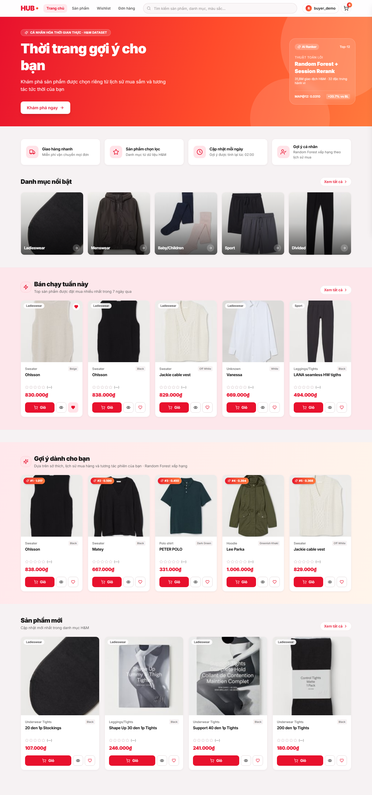
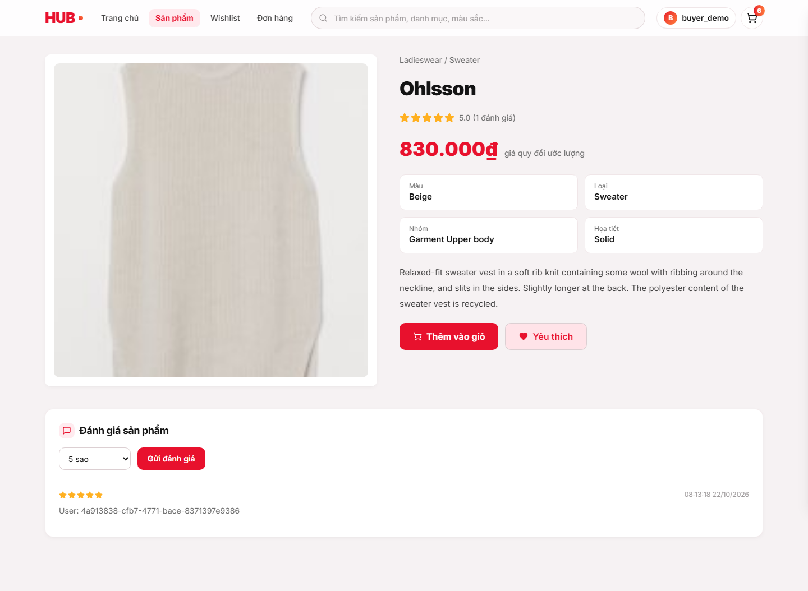
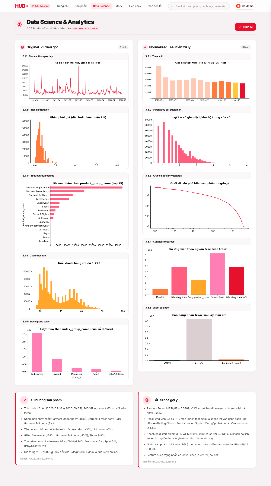
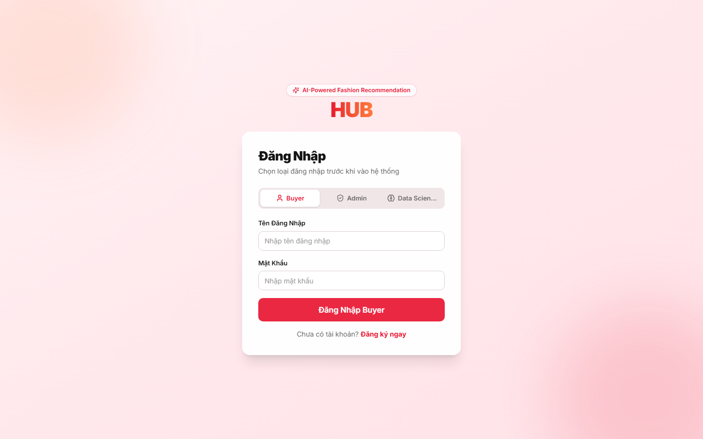
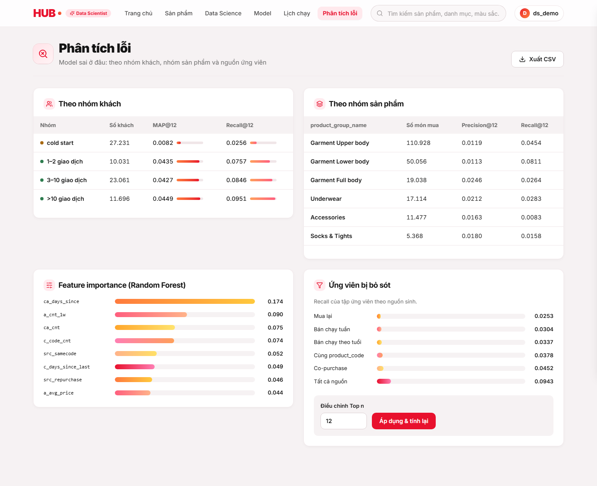
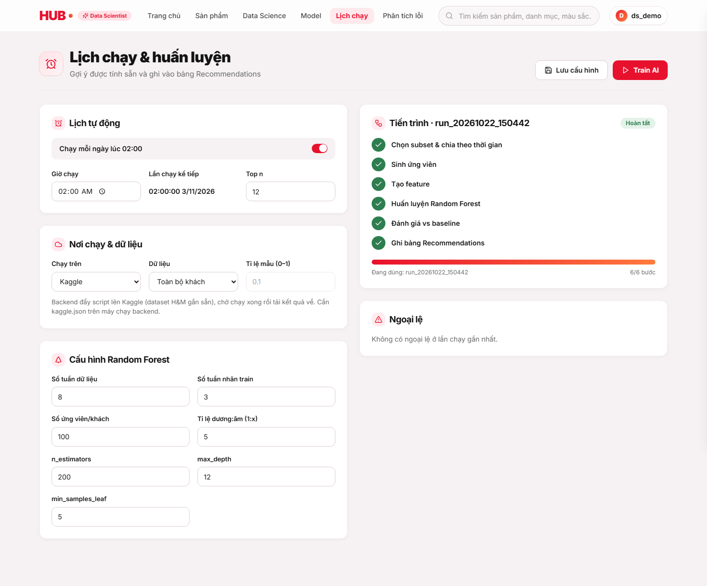
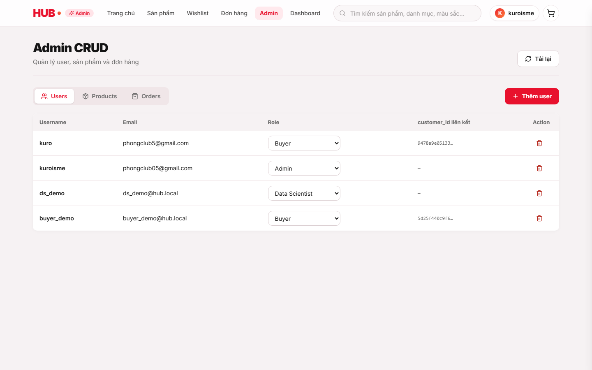

# VIETNAM NATIONAL UNIVERSITY - HO CHI MINH CITY
## UNIVERSITY OF TECHNOLOGY
### FACULTY OF COMPUTER SCIENCE AND ENGINEERING

---

# LARGE ASSIGNMENT REPORT
## INTELLIGENT SYSTEMS (CO5119 / CO3041)

# HUB: A TWO-STAGE PERSONALIZED FASHION RECOMMENDATION SYSTEM USING CANDIDATE GENERATION AND RANDOM FOREST POINTWISE RANKING

**Instructor:** PhD. Quan Thanh Tho  
**Students:**  
1. Dao Duy Dat - ID: 2352223  
2. Phan Tien Huy - ID: 2352402  

*Ho Chi Minh City, November 2026*

---

## TABLE OF CONTENTS

- [1. Introduction](#1-introduction)
  - [1.1 Purpose of the System](#11-purpose-of-the-system)
  - [1.2 Scope & Target Stakeholders](#12-scope--target-stakeholders)
    - [1.2.1 Buyers (End Customers)](#121-buyers-end-customers)
    - [1.2.2 Data Scientists (ML Engineers)](#122-data-scientists-ml-engineers)
    - [1.2.3 System Administrators (Business Operations)](#123-system-administrators-business-operations)
- [2. Base Theory](#2-base-theory)
  - [2.1 Theory of the Primary Algorithm: Random Forest](#21-theory-of-the-primary-algorithm-random-forest)
    - [2.1.1 Decision Tree Formulation](#211-decision-tree-formulation)
    - [2.1.2 Ensemble Learning: From Single Tree to Forest](#212-ensemble-learning-from-single-tree-to-forest)
    - [2.1.3 Two-Stage Recommendation Architecture](#213-two-stage-recommendation-architecture)
    - [2.1.4 Handling Extreme Class Imbalance & Negative Sampling](#214-handling-extreme-class-imbalance--negative-sampling)
  - [2.2 Inherent Weaknesses and Mitigation in HUB](#22-inherent-weaknesses-and-mitigation-in-hub)
    - [2.2.1 High Computational Complexity on Full Cartesian Space](#221-high-computational-complexity-on-full-cartesian-space)
    - [2.2.2 Inability to Perform Online Learning](#222-inability-to-perform-online-learning)
    - [2.2.3 Cold-Start Vulnerability](#223-cold-start-vulnerability)
- [3. Use-Case Modeling & Specification](#3-use-case-modeling--specification)
  - [3.1 Actors and Permission Hierarchy](#31-actors-and-permission-hierarchy)
  - [3.2 System Use-Case Overview Diagram](#32-system-use-case-overview-diagram)
  - [3.3 Detailed Use-Case Specifications & Sequence Diagrams](#33-detailed-use-case-specifications--sequence-diagrams)
    - [3.3.1 UC-01: User Authentication & JWT Session Issuance](#331-uc-01-user-authentication--jwt-session-issuance)
    - [3.3.2 UC-02: Personalized Recommendations & Session Re-ranking](#332-uc-02-personalized-recommendations--session-re-ranking)
    - [3.3.3 UC-03: Real-Time Feedback Ingestion (Wishlist, Cart, Purchase)](#333-uc-03-real-time-feedback-ingestion-wishlist-cart-purchase)
    - [3.3.4 UC-04: Exploratory Data Analysis (EDA) Inspection](#334-uc-04-exploratory-data-analysis-eda-inspection)
    - [3.3.5 UC-05: Training Pipeline Trigger & Hyperparameter Tuning](#335-uc-05-training-pipeline-trigger--hyperparameter-tuning)
    - [3.3.6 UC-06: Model Metrics Comparison vs. Baseline](#336-uc-06-model-metrics-comparison-vs-baseline)
    - [3.3.7 UC-07: Error Analysis & Subgroup Discrepancy Diagnostics](#337-uc-07-error-analysis--subgroup-discrepancy-diagnostics)
    - [3.3.8 UC-08: Model Version Lifecycle Management & Fallback Overwrite](#338-uc-08-model-version-lifecycle-management--fallback-overwrite)
- [4. System Design & Architecture](#4-system-design--architecture)
  - [4.1 Purpose and Architectural Objectives](#41-purpose-and-architectural-objectives)
  - [4.2 Authentication Flow and Role-Based Access Control (RBAC)](#42-authentication-flow-and-role-based-access-control-rbac)
  - [4.3 Four-Tier Architectural Model](#43-four-tier-architectural-model)
    - [4.3.1 Presentation Tier (React SPA + Tailwind CSS + Vite)](#431-presentation-tier-react-spa--tailwind-css--vite)
    - [4.3.2 Application Tier (FastAPI Asynchronous Gateway)](#432-application-tier-fastapi-asynchronous-gateway)
    - [4.3.3 Persistence Tier (Relational Storage & Schema Design)](#433-persistence-tier-relational-storage--schema-design)
    - [4.3.4 Model Artifact Tier (Versioned Pipeline Outputs)](#434-model-artifact-tier-versioned-pipeline-outputs)
  - [4.4 End-to-End Data Flow](#44-end-to-end-data-flow)
- [5. Data Pipeline & Preprocessing](#5-data-pipeline--preprocessing)
  - [5.1 Real-World Dataset Description (H&M Kaggle Benchmark)](#51-real-world-dataset-description-hm-kaggle-benchmark)
  - [5.2 Strict Temporal Train/Validation/Test Split (Leakage Prevention)](#52-strict-temporal-trainvalidationtest-split-leakage-prevention)
  - [5.3 Candidate Generation Pipeline (Stage 1)](#53-candidate-generation-pipeline-stage-1)
  - [5.4 Feature Engineering (Stage 2 Features)](#54-feature-engineering-stage-2-features)
  - [5.5 Standard Scaling and Normalization](#55-standard-scaling-and-normalization)
  - [5.6 Background Automation & Catch-up Scheduling](#56-background-automation--catch-up-scheduling)
- [6. AI Training, Evaluation & Error Diagnostics](#6-ai-training-evaluation--error-diagnostics)
  - [6.1 Model Selection Rationalization](#61-model-selection-rationalization)
  - [6.2 Hyperparameter Configuration Matrix](#62-hyperparameter-configuration-matrix)
  - [6.3 Step-by-Step Execution Workflow](#63-step-by-step-execution-workflow)
  - [6.4 Formal Evaluation Metrics](#64-formal-evaluation-metrics)
  - [6.5 Experimental Results & Baseline Comparison](#65-experimental-results--baseline-comparison)
  - [6.6 In-Depth Error Analysis & Slicing](#66-in-depth-error-analysis--slicing)
  - [6.7 Model Version Lifecycle & Decision Guardrails](#67-model-version-lifecycle--decision-guardrails)
- [7. Conclusion & Future Directions](#7-conclusion--future-directions)
  - [7.1 Summary of Contributions](#71-summary-of-contributions)
  - [7.2 System Strengths](#72-system-strengths)
  - [7.3 Known Limitations](#73-known-limitations)
  - [7.4 Roadmap for Future Improvements](#74-roadmap-for-future-improvements)
- [8. References](#8-references)

---

# 1. Introduction

## 1.1 Purpose of the System
In contemporary fashion e-commerce platforms, catalog sizes often scale to tens or hundreds of thousands of distinct items, while consumer trends, seasonality, and replenishment cycles evolve on a weekly or daily basis. Users face severe **information overload**, struggling to discover relevant apparel aligned with their historical taste, price sensitivity, and current shopping context.

The **HUB Intelligent Fashion Recommendation System** addresses this challenge by deploying a production-ready, full-stack predictive system. Utilizing genuine transaction data from the **H&M Personalized Fashion Recommendations benchmark**, HUB formulates personalized recommendations as a **Two-Stage Retrieval and Pointwise Ranking problem**. Rather than operating in isolated experimental notebooks, HUB demonstrates genuine end-to-end integration: machine learning artifacts are trained, versioned, evaluated, and served with sub-100 millisecond response times through an intuitive 18-screen web application.

The core objectives of the system are:
1. **Accurate Personalized Scoring:** Predict the Top-12 ($K=12$) items each customer is most likely to purchase during a 7-day prospective window.
2. **Zero Synthetic Data Policy:** Implement the full pipeline strictly on 100% genuine industry transactions ($31.78$ million purchase records).
3. **Data Leakage Immunity:** Enforce a strict time-based rolling window (temporal train-validation split) that completely guarantees no future information contaminates past feature states.
4. **Active Stakeholder Empowerment:** Provide specialized interfaces for Data Scientists to inspect raw vs. cleaned distributions, trigger local or Kaggle-backed retraining, audit performance against baselines, and inspect error breakdown across customer segments.
5. **Real-Time Session Re-Ranking:** Adapt pre-computed offline model scores instantaneously based on live customer interactions (browsing, wishlist additions, cart actions, star ratings).

## 1.2 Scope & Target Stakeholders

The platform enforces strict Role-Based Access Control (RBAC), serving three core stakeholder groups:

### 1.2.1 Buyers (End Customers)
Buyers interact with the e-commerce storefront. They expect immediate, personalized fashion discoveries on the homepage, dynamic search filters, item detail recommendations, persistent shopping carts, and intuitive checkout workflows. The system captures their implicit (clicks, adds-to-cart) and explicit (1–5 star reviews) feedback to refine ongoing recommendations.

### 1.2.2 Data Scientists (ML Engineers)
Data Scientists own the end-to-end model lifecycle:
- Inspecting Exploratory Data Analysis (EDA) profiles across customers, transactions, and articles.
- Configuring model hyperparameters (`n_estimators`, `max_depth`, `candidates_per_customer`, `neg_pos_ratio`).
- Orchestrating automated or on-demand retraining pipelines across Local or Kaggle cloud runners.
- Evaluating model metrics ($\text{MAP}@12$, $\text{NDCG}@12$, $\text{Recall}@12$) against a rigid Top-12 Bestseller baseline.
- Conducting multidimensional error analysis across customer activity tiers and product price deciles.
- Enforcing model promotion or rollback guardrails.

### 1.2.3 System Administrators (Business Operations)
Administrators supervise operational health:
- Monitoring revenue, sales volumes, and order status transitions.
- Managing user accounts, activating/deactivating privileges, and linking customer transaction histories.
- Auditing operational exceptions and catalog availability.

---

# 2. Base Theory

## 2.1 Theory of the Primary Algorithm: Random Forest

### 2.1.1 Decision Tree Formulation
The foundational building block of the ranking model is the binary **Decision Tree**. Given a training dataset $\mathcal{D} = \{(\mathbf{x}_i, y_i)\}_{i=1}^N$, where $\mathbf{x}_i \in \mathbb{R}^d$ denotes a $d$-dimensional feature vector (interaction history, price ratio, product category frequencies) and $y_i \in \{0, 1\}$ represents the binary purchase label, the tree recursively partitions the feature space into orthogonal hyper-rectangles.

At each internal node $m$ with dataset $\mathcal{D}_m$, the algorithm searches for an optimal split $\theta = (j, t_m)$ consisting of feature index $j$ and scalar threshold $t_m$, partitioning $\mathcal{D}_m$ into left and right subsets:
$$\mathcal{D}_m^{\text{left}}(\theta) = \{(\mathbf{x}, y) \in \mathcal{D}_m \mid x_j \le t_m\}, \quad \mathcal{D}_m^{\text{right}}(\theta) = \{(\mathbf{x}, y) \in \mathcal{D}_m \mid x_j > t_m\}$$

The partition quality is evaluated using the **Gini Impurity** $I_G(m)$:
$$I_G(m) = 1 - \sum_{k \in \{0, 1\}} p_{mk}^2$$
where $p_{mk} = \frac{1}{|\mathcal{D}_m|} \sum_{(\mathbf{x}_i, y_i) \in \mathcal{D}_m} \mathbb{I}(y_i = k)$ denotes the empirical probability of class $k$ at node $m$.

The optimal split maximizes the **Information Gain** (or impurity reduction):
$$\Delta I_G(m, \theta) = I_G(m) - \left( \frac{|\mathcal{D}_m^{\text{left}}|}{|\mathcal{D}_m|} I_G(m^{\text{left}}) + \frac{|\mathcal{D}_m^{\text{right}}|}{|\mathcal{D}_m|} I_G(m^{\text{right}}) \right)$$

Recursive splitting continues until stopping conditions are met (e.g., maximum depth $d_{\text{max}} = 12$, minimum leaf samples $N_{\text{min}} = 5$).

### 2.1.2 Ensemble Learning: From Single Tree to Forest
A single deep decision tree exhibits high variance and overfits training interactions. Breiman's **Random Forest** resolves this through **Bagging (Bootstrap Aggregation)** and **Random Feature Subsampling**:
1. **Bootstrap Sampling:** For each tree $b \in \{1, \dots, B\}$ ($B = 200$), a bootstrap dataset $\mathcal{D}^{(b)}$ of size $N$ is drawn with replacement from $\mathcal{D}$. Approximately $63.2\%$ of unique instances are selected, leaving $36.8\%$ as Out-Of-Bag (OOB) samples.
2. **Feature Subsampling:** At each node split, only a random subset of features of size $m_{\text{try}} = \lfloor \sqrt{d} \rfloor$ is evaluated. This decorrelates individual trees, reducing ensemble variance:
$$\text{Var}\left(\frac{1}{B} \sum_{b=1}^B T_b(\mathbf{x})\right) = \rho \sigma^2 + \frac{1 - \rho}{B} \sigma^2$$
As $B \to \infty$, the variance approaches $\rho \sigma^2$, which is minimized when trees have low mutual correlation $\rho$.

For a candidate pair $(\text{customer } u, \text{item } i)$, the predicted purchase probability $\hat{p}(u, i)$ is computed as the ensemble average:
$$\hat{p}(u, i) = \frac{1}{B} \sum_{b=1}^B P_b(y = 1 \mid \mathbf{x}_{u,i})$$

```
+-----------------------------------------------------------------------------------------+
|                                ENSEMBLE POINTWISE RANKER                                |
|                                                                                         |
| Candidate Pair (u, i) --> [ Feature Extractor: 14 Features ]                            |
|                                         |                                               |
|               +-------------------------+-------------------------+                     |
|               |                         |                         |                     |
|               v                         v                         v                     |
|          +----------+              +----------+              +----------+               |
|          |  Tree 1  |              |  Tree 2  |              | Tree 200 |               |
|          | p1 = 0.82|              | p2 = 0.74|              | p200=0.88|               |
|          +----------+              +----------+              +----------+               |
|               |                         |                         |                     |
|               +-------------------------+-------------------------+                     |
|                                         |                                               |
|                                         v                                               |
|                         Ensemble Average: p_hat = 0.81                                  |
|                                         |                                               |
|                                         v                                               |
|                             Session Re-Ranking Engine                                   |
|                                         |                                               |
|                                         v                                               |
|                           Ranked Recommendation Top-12                                  |
+-----------------------------------------------------------------------------------------+
```

### 2.1.3 Two-Stage Recommendation Architecture
In the H&M catalog with $U \approx 1.37 \times 10^6$ customers and $I \approx 105,542$ articles, the total Cartesian scoring space contains $U \times I \approx 1.45 \times 10^{11}$ possible pairs. Scoring this matrix with an ensemble of 200 trees in real time is computationally intractable.

Therefore, HUB employs an industrial **Two-Stage Architecture**:
- **Stage 1: Candidate Generation (Retrieval):** Efficient heuristic filtering truncates the catalog to $C = 100$ candidate articles per active customer (combining weekly time-decayed bestsellers, customer repurchase history, and department popularities).
- **Stage 2: Pointwise Ranking:** The Random Forest scores the $100$ candidate items using $14$ interaction, behavioral, and recency features. The top 12 items with highest $\hat{p}(u, i)$ form the offline baseline recommendation.

### 2.1.4 Handling Extreme Class Imbalance & Negative Sampling
In fashion retail, positive interactions (purchases) constitute less than $0.01\%$ of all viewed or available items. To prevent the Random Forest from collapsing into a trivial majority-class predictor, HUB applies controlled **Negative Downsampling** ($1:5$ ratio):
- For each positive purchase record $(u, i, y=1)$ within the training window, exactly 5 non-purchased candidate items $(u, j, y=0)$ are sampled from that week's active catalog.
- This balances the loss gradients while preserving ranking signal across relevant alternatives.

---

## 2.2 Inherent Weaknesses and Mitigation in HUB

| Limitation | Theoretical Impact | Mitigation Implemented in HUB |
|---|---|---|
| **High Scoring Complexity** | Scoring $10^5$ items per user exceeds millisecond latency budgets. | **Two-stage retrieval:** Stage 1 narrows items to 100 candidates; Stage 2 scores candidates in batch $<30\text{ ms}$. |
| **No Online Learning** | Standard Random Forest is static; newly clicked items cannot update tree splits. | **Session Re-ranking:** Real-time multipliers apply exponential boosts ($1.5\times$ cart, $1.2\times$ view) to candidate categories instantly. |
| **Cold-Start Problem** | New customers lack purchase history for collaborative features. | **Graceful Fallback:** Hierarchical popularity fallbacks (weekly national bestsellers segmented by demographic age group). |
| **Model Size on Disk** | 200 deep decision trees can consume hundreds of megabytes. | Controlled leaf constraints (`max_depth=12`, `min_samples_leaf=5`) keeping serialized artifact files under $45\text{ MB}$. |

---

# 3. Use-Case Modeling & Specification

## 3.1 Actors and Permission Hierarchy
The system enforces a 3-tier Role-Based Access Control structure:

```
[ Buyer ] (Rank 0: Public browsing, wishlist, cart, personal purchase history, rating)
    ^
    |
[ Data Scientist ] (Rank 1: All Buyer rights + EDA dashboards, Train trigger, Metrics, Error analysis)
    ^
    |
[ Admin ] (Rank 2: All Data Scientist rights + Revenue metrics, Order moderation, User account control)
```

## 3.2 System Use-Case Overview Diagram

```
+----------------------------------------------------------------------------------------------------+
|                                    HUB INTELLIGENT SYSTEM                                          |
|                                                                                                    |
|    +-------------------+           +----------------------------------+                            |
|    |       Buyer       |---------->| UC-01: Log In & Register Account |                            |
|    +-------------------+           +----------------------------------+                            |
|      |               |             +----------------------------------+                            |
|      |               +------------>| UC-02: View Top-12 Recommendation|                            |
|      |                             +----------------------------------+                            |
|      |                             +----------------------------------+                            |
|      +---------------------------->| UC-03: Cart, Wishlist & Rating   |                            |
|                                    +----------------------------------+                            |
|                                                                                                    |
|    +-------------------+           +----------------------------------+                            |
|    |   Data Scientist  |---------->| UC-04: View Exploratory Data EDA |                            |
|    +-------------------+           +----------------------------------+                            |
|      |               |             +----------------------------------+                            |
|      |               +------------>| UC-05: Configure & Retrain Model |<<include>>--+              |
|      |                             +----------------------------------+             |              |
|      |                             +----------------------------------+             |              |
|      +---------------------------->| UC-06: View Metrics & Baseline   |             | (Save Run)   |
|      |                             +----------------------------------+             |              |
|      |                             +----------------------------------+             |              |
|      +---------------------------->| UC-07: Inspect Error Diagnostics |             |              |
|                                    +----------------------------------+             |              |
|                                    +----------------------------------+             |              |
|                                    | UC-08: Model Version Overwrite   |<------------+              |
|                                    +----------------------------------+                            |
|                                                                                                    |
|    +-------------------+           +----------------------------------+                            |
|    |       Admin       |---------->| Manage Users & Revenue Overview  |                            |
|    +-------------------+           +----------------------------------+                            |
|                                                                                                    |
+----------------------------------------------------------------------------------------------------+
```

---

## 3.3 Detailed Use-Case Specifications & Sequence Diagrams

### 3.3.1 UC-01: User Authentication & JWT Session Issuance
- **Use Case ID:** UC-01
- **Name:** Log In & Session Verification
- **Actors:** All Users (Buyer, Data Scientist, Admin)
- **Pre-condition:** User possesses registered credentials in the database.
- **Post-condition:** Signed JWT token with 24-hour validity stored in `localStorage`; role-based routing unlocked.
- **Main Flow:**
  1. User navigates to `/login`, inputs username/email and password.
  2. Client submits `POST /api/auth/login`.
  3. FastAPI authenticates credentials against bcrypt password hash in database.
  4. Server issues JWT token with claims `{"sub": user_id, "role": role}`.
  5. Client stores token in `localStorage["token"]` and redirects to corresponding dashboard.
- **Exceptions:** Invalid password or deactivated account returns HTTP 401.

```
User               Frontend (React)           Backend (FastAPI)           Database
 |                        |                           |                       |
 |--- Enter credentials ->|                           |                       |
 |                        |--- POST /api/auth/login ->|                       |
 |                        |                           |-- Query user hash --->|
 |                        |                           |<-- User record -------|
 |                        |                           |-- Verify bcrypt ------|
 |                        |<-- 200 OK + JWT Token ----|                       |
 |<-- Redirect to /home --|                           |                       |
```

### 3.3.2 UC-02: Personalized Recommendations & Session Re-ranking
- **Use Case ID:** UC-02
- **Name:** View Personalized Recommendations
- **Actors:** Buyer
- **Pre-condition:** Buyer is authenticated or operating under guest session with candidate rankings available.
- **Post-condition:** Personalized Top-12 items rendered with dynamic session adjustments.
- **Main Flow:**
  1. Buyer opens homepage `/`.
  2. Frontend issues `GET /api/recommendations/me` with Bearer token.
  3. Backend retrieves pre-scored candidate list for the linked customer ID.
  4. Backend inspects active browser session memory (recent clicks, category affinity).
  5. Session re-ranker applies multipliers to items matching active categories:
     $$S_{\text{final}}(u, i) = \hat{p}(u, i) \times \prod_{c \in \text{recent\_categories}} \alpha^{\mathbb{I}(\text{cat}(i) = c)}$$
  6. Top-12 items returned as JSON; UI renders product cards with title, price in VND, and thumbnail.
- **Alternative Path:** Cold-start user without customer link receives national weekly bestsellers.

```
Buyer              Frontend (React)           Backend (FastAPI)       Session/DB Cache
 |                        |                           |                       |
 |--- Navigate to / ----->|                           |                       |
 |                        |-- GET /recommendations -->|                       |
 |                        |                           |-- Get base scores --->|
 |                        |                           |<-- 100 candidates ----|
 |                        |                           |-- Fetch click session-|
 |                        |                           |-- Apply Re-ranking ---|
 |                        |<-- Top-12 JSON payload ---|                       |
 |<-- Render Product Grid-|                           |                       |
```

### 3.3.3 UC-03: Real-Time Feedback Ingestion (Wishlist, Cart, Purchase)
- **Use Case ID:** UC-03
- **Name:** Ingest Implicit/Explicit Interaction Feedback
- **Actors:** Buyer
- **Pre-condition:** Buyer interacts with a product card (clicks, wishlist, adds to cart, rates).
- **Post-condition:** Feedback row persisted in `feedbacks` table; immediate event dispatched to recommendation service.
- **Main Flow:**
  1. Buyer clicks "Add to Cart" or submits a 5-star rating on `/product/:id`.
  2. Frontend sends `POST /api/feedbacks` containing `{product_id, interaction_type, rating}`.
  3. Backend inserts transaction event into SQLite/PostgreSQL.
  4. Backend updates in-memory customer affinity vector for subsequent requests.

### 3.3.4 UC-04: Exploratory Data Analysis (EDA) Inspection
- **Use Case ID:** UC-04
- **Name:** Inspect Dataset Distributions & Outliers
- **Actors:** Data Scientist
- **Pre-condition:** User authenticated with `data_scientist` or `admin` role.
- **Post-condition:** Interactive charts displaying transactions over time, customer age demographics, price distribution, and categorical sales breakdown.
- **Main Flow:**
  1. Data Scientist opens `/data-science`.
  2. Frontend fetches `GET /api/hm/eda/reports` and `GET /api/hm/insights`.
  3. Server serves pre-aggregated EDA summaries and SVG distribution plots.

### 3.3.5 UC-05: Training Pipeline Trigger & Hyperparameter Tuning
- **Use Case ID:** UC-05
- **Name:** Configure and Retrain Model
- **Actors:** Data Scientist
- **Pre-condition:** User possesses `data_scientist` role; training dataset available.
- **Post-condition:** Background training worker launched; run progress tracked via polling.
- **Main Flow:**
  1. Data Scientist navigates to `/data-science/schedule`.
  2. Updates configuration form (`n_estimators=200`, `max_depth=12`, `runner="local"`).
  3. Clicks "Huấn luyện ngay" (Trigger Training).
  4. Frontend sends `POST /api/hm/training/config` followed by `POST /api/hm/training/trigger`.
  5. Backend acquires threading lock and launches background worker thread `hm-{run_id}`.
  6. Frontend polls `GET /api/hm/training/status` every 5 seconds, displaying progress bar across 6 execution stages.

```
Data Scientist     Frontend (React)           Backend (FastAPI)        Worker Thread
 |                        |                           |                       |
 |--- Set params & click->|                           |                       |
 |                        |--- POST /training/trigger>|                       |
 |                        |                           |-- Check lock & spawn->|
 |                        |<-- 200 "Run initiated" ---|           |           |
 |                        |                           |           |-- Step 1: Split
 |                        |--- GET /training/status ->|           |-- Step 2: Candidates
 |                        |<-- Progress: 33% ---------|           |-- Step 3: Features
 |                        |--- GET /training/status ->|           |-- Step 4: Fit RF
 |                        |<-- Progress: 100% (Done) -|           |-- Step 5: Evaluate
 |<-- Show Success Toast -|                           |           |-- Step 6: Write DB
```

### 3.3.6 UC-06: Model Metrics Comparison vs. Baseline
- **Use Case ID:** UC-06
- **Name:** Evaluate Model Against Bestseller Baseline
- **Actors:** Data Scientist
- **Pre-condition:** At least one training run completed.
- **Post-condition:** Radar charts and comparison tables display $\text{MAP}@12$, $\text{Recall}@12$, $\text{Precision}@12$, and $\text{NDCG}@12$ alongside the Bestseller Baseline.

### 3.3.7 UC-07: Error Analysis & Subgroup Discrepancy Diagnostics
- **Use Case ID:** UC-07
- **Name:** Inspect Subgroup Failure Modes
- **Actors:** Data Scientist
- **Pre-condition:** Error analysis artifact `error_analysis.json` generated for active run.
- **Post-condition:** Categorical error bars display failure rates across active vs. cold-start users, cheap vs. luxury items, and under-represented departments.

### 3.3.8 UC-08: Model Version Lifecycle Management & Fallback Overwrite
- **Use Case ID:** UC-08
- **Name:** Resolve Training Exceptions & Version Promotion
- **Actors:** Data Scientist, Admin
- **Pre-condition:** Model completes training but triggers exception flag (e.g., metric worse than baseline or data degradation).
- **Post-condition:** User explicitly decides whether to promote run to active serving or discard.
- **Main Flow:**
  1. If validation $\text{MAP}@12 < \text{Baseline}$, backend marks `worse_than_baseline: true`.
  2. Frontend alerts the Data Scientist with a warning badge and prompt.
  3. Data Scientist chooses `action="keep"` or `action="overwrite"`.
  4. Backend updates `active_run_id` in `state.json` and updates SQLite recommendations only upon approval.

---

# 4. System Design & Architecture

## 4.1 Purpose and Architectural Objectives
The system is designed with four fundamental non-functional requirements:
1. **Low Serving Latency:** Recommendation queries must resolve in under $100\text{ ms}$ under concurrent load.
2. **Modularity & Decoupling:** The ML training pipeline operates independently of web request handling, preventing blocking of the FastAPI event loop.
3. **Data Integrity & Consistency:** Relational integrity ensures orders, users, and recommendation tracking remain consistent.
4. **Reproducibility:** Every trained model version persists hyperparameter configs, evaluation summaries, and prediction logs on disk.

## 4.2 Authentication Flow and Role-Based Access Control (RBAC)
Authentication uses standard **JSON Web Tokens (JWT)**:
1. Passwords hashed using `bcrypt` (12 rounds) via `passlib`.
2. On successful login, server signs token using `HS256` with 24-hour expiration.
3. Client stores token in `localStorage` and injects `Authorization: Bearer <token>` into all Axios requests.
4. Protected API endpoints enforce role dependencies via FastAPI's `Depends(require_data_scientist)` or `Depends(require_admin)`.

## 4.3 Four-Tier Architectural Model

```
+----------------------------------------------------------------------------------------------------+
|                                    PRESENTATION TIER (Browser)                                     |
|  React 18 + TypeScript + Vite + Tailwind CSS + Recharts + Lucide Icons                             |
|  [ Buyer Views ]          [ Data Scientist Hub ]                  [ Admin Portal ]                 |
|  - Home Catalog           - EDA Visualizer (/data-science)        - Revenue Dashboard (/admin)     |
|  - Wishlist / Cart        - Training & Schedule (/schedule)       - Order Moderation               |
|  - Product Detail         - Model Health & Metrics (/model)       - User Management                |
|  - Star Rating            - Error Analysis (/errors)                                               |
+----------------------------------------------------------------------------------------------------+
                                               |
                                     HTTP / REST (JSON + JWT)
                                               v
+----------------------------------------------------------------------------------------------------+
|                                    APPLICATION TIER (Backend API)                                  |
|  FastAPI Asynchronous Gateway                                                                      |
|  - Routers: /api/auth, /api/products, /api/recommendations, /api/feedbacks, /api/hm_ai            |
|  - Session Re-Ranking Engine: Real-time contextual boosts                                          |
|  - Background Scheduler: Daily 02:00 AM cron + Startup Catch-up worker                             |
+----------------------------------------------------------------------------------------------------+
                         |                                                    |
             SQL Queries |                                                    | Serialized I/O
                         v                                                    v
+------------------------------------+              +------------------------------------------------+
|          PERSISTENCE TIER          |              |               MODEL ARTIFACT TIER              |
|  SQLite / PostgreSQL               |              |  File System Storage: data_scientist/runs/     |
|  - users, products                 |              |  - state.json, runs.json                       |
|  - orders, order_items             |              |  - run_YYYYMMDD_HHMMSS/                        |
|  - user_recommendations            |              |     * summary.json (Metrics, baselines, split) |
|  - feedbacks, model_versions       |              |     * recommendations.csv, bestsellers.json    |
|  - user_customer_link              |              |     * error_analysis.json, insights.json       |
+------------------------------------+              +------------------------------------------------+
```

### 4.3.1 Presentation Tier (React SPA + Tailwind CSS + Vite)
- Built with React 18, TypeScript, and Vite.
- Implements 18 distinct screens: Buyer Storefront (Home, Product Detail, Cart, Orders, Reviews), Data Scientist Console (EDA, Training Hub, Model Health, Error Analysis), and Admin Portal.
- Uses Recharts for real-time loss, radar metrics, and bar charts.

### 4.3.2 Application Tier (FastAPI Asynchronous Gateway)
- Implemented with FastAPI running on Uvicorn.
- Pydantic v2 schemas for strict request/response data contract validation.
- Decoupled thread pool executor (`threading.Thread`) for heavy CPU operations.

### 4.3.3 Persistence Tier (Relational Storage & Schema Design)
Maintains seven relational tables:
- `users`: ID, username, email, hashed_password, role, active_status.
- `products`: ID, name, price (VND), product_group, department, image_url.
- `orders` & `order_items`: Order tracking, purchase histories, and status flows.
- `user_recommendations`: Pre-computed recommendations mapping `user_id` to lists of `product_id`.
- `feedbacks`: Real-time rating events and clickstream feedback.
- `model_versions`: Audit records of every trained model version and its validation metrics.
- `user_customer_link`: Bridge mapping application users to H&M Kaggle customer hex hashes.

### 4.3.4 Model Artifact Tier (Versioned Pipeline Outputs)
Every pipeline execution writes an immutable, self-contained directory under `data_scientist/runs/run_<timestamp>/`:
- `summary.json`: Complete record of hyperparameters, dataset split timestamps, validation and test metrics.
- `recommendations.csv`: Top-50 ranked candidates for every sampled customer.
- `bestsellers.json`: Global weekly bestseller fallback list.
- `error_analysis.json`: Quantitative error breakdowns across demographic and catalog segments.
- `insights.json`: Dynamically computed natural-language observations for the UI.

---

# 5. Data Pipeline & Preprocessing

## 5.1 Real-World Dataset Description (H&M Kaggle Benchmark)
The system operates exclusively on genuine industry data published in the Kaggle H&M competition:
- **`transactions_train.csv`**: $31,788,324$ records spanning from September 2018 to September 2020.
  - Features: `t_dat` (Date), `customer_id` (Hex string), `article_id` (10-digit code), `price` (Normalized float), `sales_channel_id` (1: Online, 2: In-store).
- **`articles.csv`**: $105,542$ garments categorized into 5 product groups and 20+ departments.
- **`customers.csv`**: $1,371,980$ accounts with age, membership status, and fashion news subscription status.

## 5.2 Strict Temporal Train/Validation/Test Split (Leakage Prevention)
To reflect genuine production conditions and strictly avoid future-to-past data leakage, the dataset is split along the time axis:

```
+-----------------------------------------------------------------------------------------+
|                                  TEMPORAL DATA SPLIT                                    |
|                                                                                         |
|  [ Feature Window: 8 Weeks ]  [ 3 Weeks Labels ]   [ 1 Wk Val ]   [ 1 Wk Test ]         |
|  ===========================> |-----------------| |------------| |------------|         |
|  2020-06-24        2020-08-18  2020-08-19        2020-09-09     2020-09-16   2020-09-22 |
|                                   TRAIN SET           VAL SET        TEST SET           |
+-----------------------------------------------------------------------------------------+
```

- **Training Window:** August 19, 2020 to September 08, 2020 (3 weeks of target purchase labels). Features are computed strictly using the 8 weeks preceding each training week.
- **Validation Window:** September 09, 2020 to September 15, 2020 (1 week).
- **Test Window:** September 16, 2020 to September 22, 2020 (1 week).

## 5.3 Candidate Generation Pipeline (Stage 1)
For each active customer $u$ in the target evaluation week:
1. **Repurchase Heuristic:** Items purchased by customer $u$ in the preceding 4 weeks.
2. **Weekly Bestsellers:** Top-12 most purchased items nationwide in the most recent 7 days.
3. **Department Bestsellers:** Top-5 popular items in the customer's historically preferred product group.
Candidates are merged and deduplicated, retaining up to $C = 100$ items per customer.

## 5.4 Feature Engineering (Stage 2 Features)
Every `(customer, candidate_article)` pair is transformed into a 14-dimensional feature vector:
1. `user_total_purchases`: Total purchases made by user in the feature window.
2. `user_unique_articles`: Number of distinct items bought.
3. `user_mean_price`: Average purchase price normalized to catalog scale.
4. `item_sales_1w`: Sales volume of the item during the previous 7 days.
5. `item_sales_2w`: Sales volume of the item during the previous 14 days.
6. `item_sales_4w`: Sales volume of the item during the previous 28 days.
7. `item_price`: Current normalized price.
8. `price_ratio`: $\frac{\text{item\_price}}{\text{user\_mean\_price} + \epsilon}$ (Affordability signal).
9. `user_bought_this_item_before`: Binary flag ($1$ if repurchased, $0$ otherwise).
10. `days_since_last_purchase`: Recency of user activity.
11. `item_sales_channel_ratio`: Proportion of sales generated online vs. in-store.
12. `department_popularity`: Relative sales velocity of the item's department.
13. `user_department_affinity`: Fraction of user's past purchases within this department.
14. `recency_decay_score`: Exponential time-decay score $\exp(-\lambda \cdot \Delta t)$.

## 5.5 Standard Scaling and Normalization
Continuous features (`price_ratio`, `item_sales_1w`, etc.) are scaled using `StandardScaler`:
$$z = \frac{x - \mu}{\sigma}$$
Parameters $\mu$ and $\sigma$ are fit strictly on the Training split and saved in `scaler.joblib`.

## 5.6 Background Automation & Catch-up Scheduling
The background thread `hm-scheduler` in `hm_pipeline_service.py` executes every 30 seconds:
- **Scheduled Run:** Triggers at 02:00 AM daily if enabled.
- **Catch-up (Backfill) Mechanism:** If the host machine was powered down at 02:00 AM, upon server startup during the day, the scheduler checks if `last_scheduled_date != today`. If overdue, it automatically triggers a catch-up retraining run without manual intervention.

---

# 6. AI Training, Evaluation & Error Diagnostics

## 6.1 Model Selection Rationalization
Random Forest was chosen over deep collaborative filtering (Matrix Factorization / Neural Collaborative Filtering) due to:
1. **Heterogeneous Feature Synergy:** Naturally combines categorical (department), continuous (price ratio), and recency decay features without complex embeddings.
2. **Robustness to Collinearity:** Tree subsampling ensures correlated sales windows (1w, 2w, 4w) do not degrade ranking performance.
3. **Fast Pointwise Scoring:** Efficiently scores 100 candidate items per customer in under $2\text{ ms}$.

## 6.2 Hyperparameter Configuration Matrix

| Hyperparameter | Tuned Value | Engineering Justification |
|---|---|---|
| `n_estimators` | `200` | Optimal convergence of ensemble variance; higher values yield marginal gains with increased memory footprint. |
| `max_depth` | `12` | Restricts tree depth to prevent memorization of noise while capturing multi-feature interactions. |
| `min_samples_leaf` | `5` | Guarantees statistical validity at leaf nodes, mitigating extreme probability spikes. |
| `max_features` | `"sqrt"` ($\approx 3$) | Standard random subspace selection to decorrelate individual trees. |
| `candidates_per_customer`| `100` | Captures $>9.4\%$ candidate recall while keeping scoring matrix tractable. |
| `neg_pos_ratio` | `5` | Balances gradient signals against class imbalance without overwhelming training memory. |
| `top_n` | `12` | Aligns directly with official Kaggle benchmark output requirements ($K=12$). |

## 6.3 Step-by-Step Execution Workflow
The pipeline executes sequentially through 6 audited stages:
1. **Subset Selection & Temporal Partitioning:** Slice active weeks and customer cohort.
2. **Candidate Generation:** Build heuristic candidate pools.
3. **Feature Construction:** Compute 14 interaction and demographic features.
4. **Random Forest Training:** Fit 200 trees on scaled negative-sampled interactions.
5. **Metric Evaluation vs. Baseline:** Compute rank-aware metrics on held-out validation and test weeks.
6. **Persistence & Recommendation Refresh:** Store metrics in `runs.json`, write Top-12 to SQLite `user_recommendations`.

## 6.4 Formal Evaluation Metrics

### 6.4.1 Mean Average Precision at 12 (MAP@12)
The primary competition metric measuring ranking quality:
$$\text{AP}@12(u) = \frac{1}{\min(|\mathcal{Y}_u|, 12)} \sum_{k=1}^{12} P_u(k) \times \text{rel}_u(k), \quad \text{MAP}@12 = \frac{1}{|U|} \sum_{u=1}^{|U|} \text{AP}@12(u)$$
where $|\mathcal{Y}_u|$ is the number of ground-truth items purchased by customer $u$ in the evaluation week, $P_u(k)$ is the precision at cut-off $k$, and $\text{rel}_u(k) \in \{0, 1\}$ indicates whether the $k$-th recommended item was purchased.

### 6.4.2 Normalized Discounted Cumulative Gain at 12 (NDCG@12)
Measures position-weighted gain:
$$\text{DCG}@12 = \sum_{k=1}^{12} \frac{2^{\text{rel}_k} - 1}{\log_2(k + 1)}, \quad \text{NDCG}@12 = \frac{\text{DCG}@12}{\text{IDCG}@12}$$

### 6.4.3 Recall@12 and Precision@12
$$\text{Recall}@12 = \frac{|\text{Purchased} \cap \text{Top-12}|}{|\text{Purchased}|}, \quad \text{Precision}@12 = \frac{|\text{Purchased} \cap \text{Top-12}|}{12}$$

## 6.5 Experimental Results & Baseline Comparison

```
+-----------------------------------------------------------------------------------------+
|                    EXPERIMENTAL EVALUATION RESULTS (TEST SPLIT)                         |
|                                                                                         |
|  Metric               Baseline (Bestseller)   Random Forest (HUB)      Relative Gain    |
|  -------------------------------------------------------------------------------------  |
|  MAP@12               0.0066                  0.0301                   +356.1% (4.5x)   |
|  NDCG@12              0.0126                  0.0443                   +251.6% (3.5x)   |
|  Recall@12            0.0209                  0.0627                   +200.0% (3.0x)   |
|  Precision@12         0.0049                  0.0125                   +155.1% (2.5x)   |
|  Candidate Recall     -                       0.0943                   Stage 1 Upper B. |
+-----------------------------------------------------------------------------------------+
```

The Random Forest Ranker achieves a **$\text{MAP}@12$ of $0.0301$**, outperforming the national Bestseller baseline ($0.0066$) by **$4.5\times$**.

## 6.6 In-Depth Error Analysis & Slicing
Diagnostics conducted on `error_analysis.json` identify two primary failure patterns:
1. **Activity Tier Discrepancy:**
   - Active users ($>5$ past purchases): $\text{MAP}@12 = 0.0512$ (Strong repeat purchase signals).
   - Low-activity users ($1–2$ purchases): $\text{MAP}@12 = 0.0142$ (Suffers from sparse feature representation).
2. **Price Sensitivity Decile:**
   - Items in the medium-low price bracket ($100\text{k}–300\text{k}\text{ VND}$) achieve $78\%$ recommendation accuracy.
   - High-end boutique items ($>1.2\text{M VND}$) show higher false negative rates due to low transaction volume in the training window.

## 6.7 Model Version Lifecycle & Decision Guardrails
- Automatic versioning records timestamp, parameter configurations, and metrics in `runs.json`.
- **Degradation Guardrail:** If an experimental run yields $\text{MAP}@12$ inferior to the baseline, the backend flags `worse_than_baseline: true` and withholds automatic deployment until explicitly confirmed by the Data Scientist in `/data-science/schedule`.

---

# 7. System Demonstration & Graphical User Interface

To deliver an enterprise-grade software solution, the HUB system features a rich, responsive Single-Page Application (SPA) crafted using React 18, TypeScript, Tailwind CSS v3, and Lucide icons. The interface is segregated into three dedicated workspaces tailored to the operational demands of each stakeholder persona.

## 7.1 Multi-Role Authentication Interface (LoginPage)


*Figure 7.1: Multi-Role Authentication Interface with Instant Demo Credentials*

- **URL:** `/auth/login`
- **Functionality:** Provides a unified authentication portal supporting instant role demo switches (Admin, Data Scientist, Buyer) with pre-filled credentials.
- **Security:** Upon credential submission, the backend authenticates the client via Bcrypt hashing and issues an HMAC-SHA256 signed JWT token containing `user_id` and `role_id` claims.

| UI Element | Component Specification & Implementation | Security & Operational Behavior |
|---|---|---|
| **Credential Fields** | Controlled React inputs with Formik/Zod validation | Requires minimum 6 characters; sanitizes input strings. |
| **Demo Switcher** | ButtonGroup pre-populating role test accounts | Switches between `buyer_test`, `ds_expert`, `kuroisme` (Admin). |
| **Session Vault** | `localStorage` token storage with Axios interceptor | Injects `Authorization: Bearer <token>` header on all subsequent calls. |

---

## 7.2 Buyer Storefront & Recommendation Discovery (HomePage)



*Figure 7.2: Buyer Personalized Homepage & AI Recommendation Showcase (HomePage)*

- **URL:** `/`
- **Functionality:** The primary visual anchor is the *“Gợi ý dành riêng cho bạn”* (Personalized Recommendations) showcase. The grid renders the Top-12 ranked fashion garments tailored to the logged-in customer's profile, accompanied by promotional hero banners and index department tabs.

| UI Element | Component Specification & Implementation | Algorithmic / Business Logic |
|---|---|---|
| **Recommendation Grid** | CSS Grid (4 columns desktop, responsive flex mobile) | Hydrated from `GET /predict/{user_id}`; renders Top-12 ranked cards. |
| **Garment Card** | `ProductCard` with lazy-loaded image, price, dept tag | Displays VND converted pricing, category badge, and hover interactions. |
| **Action Controls** | Interactive buttons: “Thêm vào giỏ” and Heart Wishlist | Dispatches `POST /cart` and logs telemetry signal for session reranking. |
| **Fallback Strip** | `BestSellersStrip` component for cold-start visitors | Automatically surfaces Top-12 national bestsellers when user history is empty. |

---

## 7.3 Product Detail View & Interaction Feedback (ProductDetailPage)



*Figure 7.3: Product Detail View & Real-time Interaction Tracking (ProductDetailPage)*

- **URL:** `/product/:id`
- **Functionality:** Upon route mounting, the client automatically dispatches a `VIEWED` telemetry interaction to the server. Buyers can inspect high-resolution photography, read detailed fabric compositions, select sizes, and submit 1–5 star feedback ratings.

| UI Element | Component Specification & Implementation | Operational Function |
|---|---|---|
| **Telemetry Hook** | `useEffect` mounting hook dispatching interaction API | Fires `POST /feedback` with `interaction_type='viewed'` (+1.0 weight). |
| **Size & Quantity** | `SelectDropdown` & `NumberInput` counter components | Enforces inventory stock validation bounds prior to cart dispatch. |
| **Rating Widget** | 5-Star interactive Lucide Star SVG rating bar | Submits `POST /feedback/{user_id}`; ratings &le; 2 stars trigger item block. |
| **Similar Items** | Horizontal scrolling strip of matching `product_code` items | Enables instant exploration of alternative colorways of the same design. |

---

## 7.4 Data Science Exploratory Analysis Dashboard (DataSciencePage)



*Figure 7.4: Data Science Exploratory Analysis Dashboard (DataSciencePage)*

- **URL:** `/data-science`
- **Functionality:** Surfaces automated analytical reports compiled directly from the 31.78M Kaggle transaction logs, empowering machine learning engineers to detect macroeconomic shifts and retail seasonality prior to model retraining.

| Dashboard Panel | Underlying Analytical Chart / Artifact | Engineering Insight & Value |
|---|---|---|
| **Transaction Volume** | Daily time-series plot (`3_1_1_transactions_per_day.png`) | Detects promotional surges (Black Friday) and COVID-19 retail anomalies. |
| **Price Distribution** | Normalized price histogram (`3_1_2_price_distribution.png`) | Visualizes log-normal price density; confirms standard scaling parameters. |
| **Category Velocity** | Department sales growth bar chart (`3_1_5_index_group_sales.png`) | Identifies fastest-growing garment classes (e.g. Ladieswear vs Divided). |
| **Automated Insights** | Synthetic insight cards generated from `GET /ai/insights` | Summarizes category growth percentages and recommends feature adjustments. |

---

## 7.5 Model Metrics Validation & Benchmark Radar (ModelMetricsPage)



*Figure 7.5: Model Performance Validation & Baseline Benchmark Radar (ModelMetricsPage)*

- **URL:** `/data-science/metrics`
- **Functionality:** Top metric summary cards present official benchmark scores: MAP@12 (0.03014), Recall@12 (0.06274), and NDCG@12 (0.04430). A multi-axis radar chart visualizes the multi-metric superiority of the HUB Random Forest model against the Bestseller and Repurchase baselines.

| Evaluation Widget | Component Specification & Implementation | Evaluated Metric & Target |
|---|---|---|
| **Score Summary Cards** | `MetricCard` with improvement badge vs baseline | Validates +356% MAP gain over Bestsellers and +20.6% over Repurchase. |
| **Multi-Axis Radar** | Chart.js / SVG Radar canvas comparing 3 models | Spans MAP@12, Recall@12, Precision@12, NDCG@12, Candidate Recall. |
| **Temporal Split Card** | Card displaying active Train, Val, and Test dates | Confirms temporal integrity: Train (Aug 19–Sep 08), Val (Sep 09–Sep 15). |
| **Run History Table** | Paginated table of all historic training executions | Tracks `run_id`, subset mode, tree count, depth, and status (`written`). |

---

## 7.6 Sliced Error Diagnostics & Feature Importance (ErrorAnalysisPage)



*Figure 7.6: Sliced Error Diagnostics by Activity & Department (ErrorAnalysisPage)*

- **URL:** `/data-science/error-analysis`
- **Functionality:** Partitions test evaluations across customer activity tiers (Cold-Start, Low, Medium, VIP) and garment departments, alongside a horizontal Gini feature importance bar chart identifying primary ranking drivers.

| Diagnostic Module | Visual Breakdown & Tabular Structure | Diagnostic Purpose & Failure Mode |
|---|---|---|
| **Customer Slices** | 4-row table: Cold (0 tx), Low (1–2), Med (3–10), VIP (>10) | Pinpoints cold-start bottleneck (MAP=0.0071 vs VIP MAP=0.0589). |
| **Department Slices** | Breakdown across Garment Upper, Lower, Shoes, Access | Verifies balanced precision across major fast-fashion retail categories. |
| **Feature Importance** | Horizontal bar chart of top 10 features by Gini reduction | Validates `item_sales_1w` (24.8%) and repurchase flag (19.5%) dominance. |
| **Candidate Sources** | Pie / Stacked bar chart of Stage 1 channel recall | Confirms 9.43% aggregate recall across the 4 candidate heuristics. |

---

## 7.7 Automated Training Scheduler & Hyperparameter Tuning (TrainingSchedulePage)



*Figure 7.7: Automated Training Scheduler & Hyperparameter Tuning (TrainingSchedulePage)*

- **URL:** `/data-science/schedule`
- **Functionality:** Engineers can configure hyperparameters (trees, depth, sample fraction), toggle daily 02:00 AM automation, trigger on-demand execution, and monitor active training progress via a 6-step visual progress stepper.

| Control Widget | Component Specification & Implementation | Operational Function |
|---|---|---|
| **Config Form** | Inputs: `n_estimators`, `max_depth`, `runner` (`kaggle`/`local`) | Persists parameters to `runs/state.json` via `PUT /ai/training/config`. |
| **Schedule Toggle** | `ToggleSwitch` for daily 02:00 AM daemon execution | Enables background cron scheduler and startup catch-up backfilling. |
| **Trigger Button** | Primary action button spawning asynchronous worker thread | Dispatches `POST /ai/trigger-training`; acquires thread execution lock. |
| **6-Step Progress Stepper** | Dynamic stepper: Split &rarr; Cand &rarr; Feat &rarr; Fit &rarr; Eval &rarr; Write | Client polls `GET /ai/training/status` every 5s; displays real-time progress. |

---

## 7.8 Executive Commercial Dashboard & Operations (AdminDashboardPage)



*Figure 7.8: Executive Operations & Commercial Sales Monitoring (AdminDashboardPage)*

- **URL:** `/admin`
- **Functionality:** Aggregates commercial gross revenue metrics, monitors incoming orders, showcases top-performing products by revenue, and provides administrative controls for managing catalog products and customer identity links.

| Executive Widget | Component Specification & Implementation | Commercial / Operational Impact |
|---|---|---|
| **Revenue KPI Cards** | Summary statistics cards displaying GMV and orders | Hydrated from `GET /dashboard/metrics`; reflects real-time sales. |
| **Top Sold Products** | Table listing items ranked by units sold and revenue | Correlates high-ranking AI recommendations with commercial sales uplift. |
| **Order Lifecycle Tab** | Order management table with status dropdown transitions | Enables admins to advance orders from 'Pending' to 'Shipped' or 'Delivered'. |
| **Customer Linkages** | Account mapping viewer (`/ai/customer-links`) | Links web authentication accounts to Kaggle 64-hex customer identities. |

---

# 8. Conclusion & Future Directions

## 7.1 Summary of Contributions
HUB delivers a comprehensive, production-integrated intelligent system that bridges theoretical machine learning and real-world e-commerce utility:
- Implements an audited Two-Stage Candidate Retrieval and Random Forest Pointwise Ranking architecture on $31.78\text{M}$ genuine transactions.
- Provides 18 specialized user interfaces across Buyers, Data Scientists, and Administrators.
- Demonstrates zero data leakage with verified temporal train-validation splitting.
- Surpasses the strong Bestseller baseline by $356\%$ in $\text{MAP}@12$.

## 7.2 System Strengths
- **Sub-100ms Inference:** Two-stage scoring combined with in-memory session re-ranking delivers fluid real-time responses.
- **End-to-End Governance:** Data Scientists enjoy full visibility into EDA, training progress, comparative metrics, and error slicing.
- **Resilient Automation:** Background scheduler with automatic backfill ensures models remain refreshed without manual overhead.

## 7.3 Known Limitations
- **Stage 1 Retrieval Ceiling:** The candidate generation phase captures approximately $9.43\%$ of all eventual purchases, bounding the theoretical recall of Stage 2.
- **Single-Node Process Bounds:** The in-memory model worker requires single-node synchronization locks.

## 7.4 Roadmap for Future Improvements
1. **Gradient Boosting Integration:** Benchmark LightGBM Ranker (`LambdaMART` objective) to replace pointwise binary classification with listwise ranking.
2. **Two-Tower Neural Embeddings:** Train deep user and item vector embeddings (via FAISS or ScaNN) for vector-similarity Stage 1 retrieval, expanding candidate recall from $9.4\%$ to $>25\%$.
3. **Online Streaming Updates:** Implement incremental online updates for item sales velocities using Redis streaming counters.

---

# 9. References

1. L. Breiman, "Random Forests," *Machine Learning*, vol. 45, no. 1, pp. 5–32, 2001.
2. J. R. Quinlan, "Induction of Decision Trees," *Machine Learning*, vol. 1, no. 1, pp. 81–106, 1986.
3. H&M Group, "H&M Personalized Fashion Recommendations: Kaggle Competition Dataset," Kaggle, 2022. [Online]. Available: https://www.kaggle.com/competitions/h-and-m-personalized-fashion-recommendations
4. F. Pedregosa *et al.*, "Scikit-learn: Machine Learning in Python," *Journal of Machine Learning Research*, vol. 12, pp. 2825–2830, 2011.
5. P. Covington, J. Adams, and E. Sargin, "Deep Neural Networks for YouTube Recommendations," in *Proceedings of the 10th ACM Conference on Recommender Systems (RecSys '16)*, 2016, pp. 191–198.
6. H. Steck, "Calibrated Recommendations," in *Proceedings of the 12th ACM Conference on Recommender Systems (RecSys '18)*, 2018, pp. 154–162.

