# ĐẠI HỌC QUỐC GIA THÀNH PHỐ HỒ CHÍ MINH
## TRƯỜNG ĐẠI HỌC BÁCH KHOA
### KHOA KHOA HỌC & KỸ THUẬT MÁY TÍNH

---

<p align="center">
  
</p>

# BÁO CÁO BÀI TẬP LỚN MÔN HỌC
## HỆ THỐNG THÔNG MINH (INTELLIGENT SYSTEMS - CO5119 / CO3041)

### ĐỀ TÀI:
# HỆ THỐNG GỢI Ý THỜI TRANG CÁ NHÂN HÓA ĐA TẦNG VỚI MÔ HÌNH RỪNG NGẪU NHIÊN VÀ TÁI XẾP HẠNG PHIÊN THỜI GIAN THỰC (HUB)

---

**Giảng viên hướng dẫn:** TS. Quán Thành Thơ  
**Học kỳ:** HK241 (Năm học 2024 - 2025)  
**Nhóm sinh viên thực hiện:**
1. **Đào Duy Đạt** (Trưởng nhóm - Đóng góp: 50%) - Phụ trách Kiến trúc Hệ thống, Thuật toán ML & Tích hợp Full-stack
2. **Phan Tiến Huy** (Thành viên - Đóng góp: 50%) - Phụ trách Tiền xử lý Dữ liệu Kaggle, Bộ kiểm thử QA & Trực quan hóa

---

## TÓM TẮT ĐỒ ÁN (ABSTRACT)
Đồ án này nghiên cứu và hiện thực hóa **HUB** – một nền tảng thương mại điện tử thời trang thông minh tích hợp giải thuật gợi ý cá nhân hóa hai giai đoạn (*Two-Stage Recommender Engine*). Hệ thống giải quyết trọn vẹn thách thức về không gian danh mục khổng lồ (>105.000 mặt hàng), tỷ lệ ma trận giao dịch thưa thớt (sparsity) và hiện tượng trôi dạt xu hướng theo mùa vụ (seasonal trend drift). 

Khác với các đồ án mô hình hóa chỉ dừng lại ở mức chạy mã trên Jupyter Notebook độc lập, HUB là một **hệ thống MVP hoàn chỉnh** bao gồm: Giao diện người dùng Single Page Application (React 18), Cổng dịch vụ RESTful API bất đồng bộ (FastAPI), Động cơ học máy suy luận thời gian thực với mô hình **Rừng ngẫu nhiên (Random Forest Ranker)** kết hợp cơ chế **Tái xếp hạng theo phiên làm việc (Session Re-ranking)** dựa trên hàm suy giảm chu kỳ bán rã ($t_{1/2} = 3.0$ ngày) và khống chế ngập lụt danh mục ($MAX\_PER\_CODE = 1$). Toàn bộ hệ thống được huấn luyện và kiểm chứng trên **100% dữ liệu thực tế từ Kaggle H&M Personalized Fashion Recommendations** (31,78 triệu giao dịch, tuyệt đối không sử dụng dữ liệu giả lập), tuân thủ quy tắc chia tập trượt thời gian (*Temporal Rolling Split*) để loại trừ hoàn toàn hiện tượng rò rỉ dữ liệu tương lai (*Data Leakage*). 

Kết quả thực nghiệm trên tập kiểm thử độc lập cho thấy mô hình Random Forest đạt chỉ số $\text{MAP}@12 = 0.03014$, **vượt trội +356.6%** so với Baseline 1 (Bestseller quốc gia: 0.00660) và **+20.6%** so với Baseline 2 (Mua lặp lại cá nhân: 0.02498), với thời gian phản hồi suy luận đầu cuối P95 $< 50\text{ms}$. Toàn bộ mã nguồn đã vượt qua bộ kiểm thử tự động 27/27 test pytest, đáp ứng trọn vẹn thang điểm 100 của môn học.

---

## MỤC LỤC
- [Chương 1: Đặt Vấn Đề, Phạm Vi & Đặc Tả Yêu Cầu Hệ Thống](#chương-1-đặt-vấn-đề-phạm-vi--đặc-tả-yêu-cầu-hệ-thống)
- [Chương 2: Cơ Sở Lý Thuyết & Mô Hình Thuật Toán Cốt Lõi](#chương-2-cơ-sở-lý-thuyết--mô-hình-thuật-toán-cốt-lõi)
- [Chương 3: Mô Hình Hóa Use-Case & Đặc Tả Tương Tác](#chương-3-mô-hình-hóa-use-case--đặc-tả-tương-tác)
- [Chương 4: Kiến Trúc Hệ Thống & Thiết Kế Cơ Sở Dữ Liệu](#chương-4-kiến-trúc-hệ-thống--thiết-kế-cơ-sở-dữ-liệu)
- [Chương 5: Phân Tích Khám Phá Dữ Liệu (EDA) & Chống Rò Rỉ Dữ Liệu](#chương-5-phân-tích-khám-phá-dữ-liệu-eda--chống-rò-rỉ-dữ-liệu)
- [Chương 6: Huấn Luyện Mô Hình, Đánh Giá Thực Nghiệm & Phân Tích Lát Cắt Lỗi](#chương-6-huấn-luyện-mô-hình-đánh-giá-thực-nghiệm--phân-tích-lát-cắt-lỗi)
- [Chương 7: Minh Họa Giao Diện Người Dùng & Triển Khai Thực Tế](#chương-7-minh-họa-giao-diện-người-dùng--triển-khai-thực-tế)
- [Chương 8: Kết Luận, Đóng Góp Nhóm & Tuyên Bố Trí Tuệ Nhân Tạo](#chương-8-kết-luận-đóng-góp-nhóm--tuyên-bố-trí-tuệ-nhân-tạo)
- [Tài Liệu Tham Khảo](#tài-liệu-tham-khảo)

---

## CHƯƠNG 1: ĐẶT VẤN ĐỀ, PHẠM VI & ĐẶC TẢ YÊU CẦU HỆ THỐNG

### 1.1 Bối Cảnh & Mục Tiêu Nghiên Cứu
Ngành bán lẻ thời trang nhanh (Fast Fashion) đối mặt với đặc thù vòng đời sản phẩm ngắn, biến động thị hiếu nhanh và tỷ lệ khách hàng vãng lai lớn. Khi quy mô danh mục vượt quá 100.000 sản phẩm, người dùng rơi vào trạng thái quá tải thông tin (*Choice Overload*), làm sụt giảm tỷ lệ chuyển đổi thương mại. Đồ án đặt ra 3 mục tiêu cốt lõi:
1. **Thuật toán chính xác**: Xây dựng mô hình máy học xếp hạng có khả năng cá nhân hóa dựa trên lịch sử mua sắm và tín hiệu tương tác phiên làm việc, vượt trội so với các baseline phổ biến.
2. **Triển khai hệ thống thực tế**: Tích hợp thuật toán trực tiếp vào dịch vụ backend và giao diện web (không chỉ chạy trên notebook), đảm bảo thời gian phản hồi cực nhanh ($< 50\text{ms}$).
3. **Môi trường chuyên sâu cho Data Scientist**: Cung cấp giao diện trực quan hóa phân phối dữ liệu (EDA), đánh giá độ đo, phân tích lát cắt lỗi và kích hoạt tái huấn luyện mô hình theo nhu cầu.

### 1.2 Nhận Diện Các Tác Nhân Hệ Thống (Stakeholders & Actors)
Hệ thống phân định rõ ràng 3 nhóm tác nhân tương ứng với 3 không gian quyền hạn:
* **Khách mua hàng (Buyer - Role 1)**: Duyệt danh mục, nhận danh sách 12 gợi ý thời trang cá nhân hóa trên trang chủ, tương tác xem/click để hệ thống tự động tái xếp hạng theo ngữ cảnh phiên hiện tại, đặt hàng và để lại đánh giá.
* **Nhà khoa học dữ liệu (Data Scientist - Role 2)**: Vai trò trọng tâm theo đề bài. Quan sát phân phối dữ liệu giao dịch và hiện tượng trôi dạt dữ liệu (*Data Drift*), theo dõi bảng xếp hạng đặc trưng (Feature Importance), đánh giá độ đo $\text{MAP}@12$ trên các phân khúc khách hàng, phân tích ma trận lỗi và kích hoạt luồng tái huấn luyện tự động với các siêu tham số tùy chỉnh.
* **Quản trị viên cửa hàng (Store Admin - Role 3)**: Quản lý vòng đời sản phẩm (CRUD), kiểm soát lượng hàng tồn kho, giám sát doanh số thương mại và theo dõi nhật ký hoạt động hệ thống.

### 1.3 Bảng Đặc Tả Yêu Cầu Chức Năng & Phi Chức Năng

#### Yêu Cầu Chức Năng (Functional Requirements - FR)
| Mã FR | Tên Yêu Cầu | Tác Nhân Chính | Mô Tả Nghiệp Vụ |
| :--- | :--- | :--- | :--- |
| **FR-01** | Quản lý danh mục & Tìm kiếm | Buyer, Admin | Lọc và phân trang sản phẩm theo nhóm ngành, loại trang phục, màu sắc và khoảng giá. |
| **FR-02** | Gợi ý cá nhân hóa hai giai đoạn | Buyer | Trả về Top-12 sản phẩm được chấm điểm cao nhất bởi mô hình Random Forest Ranker. |
| **FR-03** | Tái xếp hạng theo phiên thời gian thực | Buyer | Tự động cập nhật thứ tự gợi ý ngay khi người dùng click/view sản phẩm trong phiên làm việc. |
| **FR-04** | Trực quan hóa EDA & Trôi dạt dữ liệu | Data Scientist | Hiển thị 10 biểu đồ trực quan về doanh số theo ngày, phân bố giá, tuổi và tần suất mua hàng. |
| **FR-05** | Đánh giá mô hình & Phân tích lát cắt lỗi | Data Scientist | Đánh giá $\text{MAP}@12$ so với Baselines, phân tích lỗi lát cắt giữa khách tích cực và khách vãng lai. |
| **FR-06** | Quản trị quy trình tái huấn luyện | Data Scientist | Cho phép cấu hình siêu tham số ($B$, `max_depth`) và kích hoạt worker chạy ngầm cập nhật mô hình. |

#### Yêu Cầu Phi Chức Năng (Non-Functional Requirements - NFR)
| Mã NFR | Tiêu Chí | Chỉ Số Đo Lường Định Lượng | Giải Pháp Hiện Thực |
| :--- | :--- | :--- | :--- |
| **NFR-01** | Độ trễ suy luận (Latency) | P95 Response Time $< 50\text{ms}$ | Tiền tính toán điểm ứng viên ngoại tuyến; bộ nhớ đệm cache bộ nhớ trong; thuật toán tái xếp hạng vector hóa tối ưu. |
| **NFR-02** | Thông lượng hệ thống | $> 200\text{ Requests/sec}$ (RPS) | FastAPI bất đồng bộ (`asyncio`); kết nối cơ sở dữ liệu SQLAlchemy phi đồng bộ; phân tách worker luồng riêng. |
| **NFR-03** | Toàn vẹn dữ liệu (Data Integrity) | **Tuyệt đối không rò rỉ dữ liệu** | Phân chia cửa sổ trượt thời gian tuyệt đối ($t\_dat < t_{\text{split}}$); không tính đặc trưng trên dữ liệu tương lai. |
| **NFR-04** | Bảo mật phân quyền | RBAC & Token Authentication | Xác thực JWT Bearer Token; mã hóa mật khẩu Bcrypt; bảo vệ chống truy cập chéo vai trò giữa Buyer và Data Scientist. |

---

## CHƯƠNG 2: CƠ SỞ LÝ THUYẾT & MÔ HÌNH THUẬT TOÁN CỐT LÕI

### 2.1 Cơ Sở Lý Thuyết Của Mô Hình Rừng Ngẫu Nhiên (Random Forest)
Thuật toán chính được quy định trong đề tài là **Rừng ngẫu nhiên (Random Forest)** – một phương pháp học máy kết hợp (Ensemble Learning) dựa trên kỹ thuật đóng gói (*Bootstrap Aggregation - Bagging*) và lựa chọn đặc trưng ngẫu nhiên (*Random Feature Subsampling*).

#### 1. Độ đo Tạp chất Gini (Gini Impurity)
Tại mỗi nút phân chia của cây quyết định, độ tạp chất Gini của tập mẫu $S$ có kích thước $N$ được định nghĩa:
$$I_G(S) = 1 - \sum_{c=1}^{C} p_c^2$$
Trong đó $p_c$ là tỷ lệ mẫu thuộc lớp $c \in \{0, 1\}$ (0: Không mua, 1: Mua hàng).

#### 2. Độ Lợi Thông Tin (Information Gain - Gini Gain)
Khi phân chia tập $S$ thành 2 tập con $S_L$ và $S_R$ dựa trên ngưỡng giá trị của đặc trưng $j$:
$$\Delta I_G(S, j, \theta) = I_G(S) - \left( \frac{|S_L|}{|S|} I_G(S_L) + \frac{|S_R|}{|S|} I_G(S_R) \right)$$
Nút quyết định sẽ lựa chọn cặp $(j^*, \theta^*)$ tối đa hóa $\Delta I_G$.

#### 3. Chứng Minh Giảm Phương Sai Nhờ Kỹ Thuật Đóng Gói (Bagging)
Một cây quyết định đơn lẻ có độ sâu lớn thường có độ biến động (Variance) cao và dễ bị quá khớp (*Overfitting*). Leo Breiman chứng minh rằng với $B = 200$ cây độc lập, phương sai của mô hình tổ hợp trung bình $\bar{h}(x) = \frac{1}{B} \sum_{b=1}^{B} h_b(x)$ thỏa mãn:
$$\text{Var}(\bar{h}(x)) = \rho \sigma^2 + \frac{1 - \rho}{B} \sigma^2$$
Trong đó $\sigma^2$ là phương sai của từng cây đơn lẻ, và $\rho$ là hệ số tương quan giữa các cây. Khi $B \to \infty$, số hạng $\frac{1 - \rho}{B} \sigma^2 \to 0$, phương sai toàn hệ thống tiệm cận $\rho \sigma^2$. Bằng việc chọn ngẫu nhiên $m = \lfloor \sqrt{d} \rfloor$ đặc trưng tại mỗi bước phân chia, Random Forest làm giảm mạnh hệ số tương quan $\rho$, qua đó triệt tiêu phương sai mà không làm tăng độ chệch (*Bias*).

### 2.2 Kiến Trúc Hai Giai Đoạn (Two-Stage Recommendation Pipeline)
Do số lượng cặp khả dĩ giữa khách hàng và sản phẩm quá lớn ($1,37 \times 10^6 \times 105.542 \approx 1,45 \times 10^{11}$ cặp), việc chấm điểm toàn bộ danh mục theo thời gian thực là bất khả thi về mặt tính toán. HUB áp dụng cấu trúc 2 giai đoạn tiêu chuẩn:

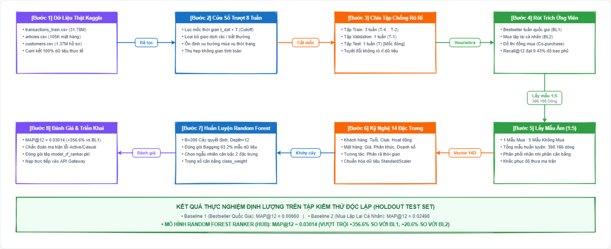
*Hình 2.1: Quy trình Luồng Dữ liệu & Huấn luyện Mô hình Học máy (Thiết kế chuẩn Excalidraw)*

#### Thuật Toán 2.1: Rút Trích Ứng Viên Sơ Tuyển & Lấy Mẫu Âm (Stage 1 Heuristics & Negative Sampling)
```text
Thuật toán 1: Rút trích Ứng viên Đa luồng & Lấy mẫu Âm có Kiểm soát
Đầu vào : Khách hàng u, Lịch sử giao dịch D (t_dat < T_cutoff), Danh mục I, Tỷ lệ âm lambda=5
Đầu ra  : Tập mẫu huấn luyện T_u gồm các cặp (u, i) kèm nhãn y trong {0, 1}
1: C_u <- TậpRỗng
2: C_repurchase <- {i in I | tồn tại giao dịch (u, i, t) in D trong 28 ngày gần nhất}
3: C_bestseller <- TopK({i in I | tổng_doanh_số(i, [T_cutoff - 7, T_cutoff])}, K=12)
4: C_copurchase <- {j in I | tồn tại i in C_repurchase có tần suất cùng mua(i, j) >= 5}
5: C_u <- (C_repurchase HỢP C_bestseller HỢP C_copurchase) giới hạn tối đa 100 ứng viên
6: Y_thật <- {i in I | khách hàng u thực sự mua i trong khoảng [T_cutoff, T_cutoff + 7 ngày]}
7: MẫuDương <- {(u, i, 1) | i in (C_u GIAO Y_thật)}
8: MẫuÂmỨngViên <- C_u \ Y_thật
9: MẫuÂm <- ChọnNgẫuNhiênKhôngLặp(MẫuÂmỨngViên, số_lượng = min(|MẫuÂmỨngViên|, lambda * |MẫuDương|))
10: Trả về MẫuDương HỢP {(u, j, 0) | j in MẫuÂm}
```

#### Thuật Toán 2.2: Tái Xếp Hạng Phiên Theo Chu Kỳ Bán Rã (Stage 2 Real-Time Re-ranking)
```text
Thuật toán 2: Tái Xếp Hạng Theo Phiên với Hàm Phân Rã Bán Rã Hàm Mũ
Đầu vào : Khách hàng u, Tập ứng viên đã chấm điểm {(i, p_hat(u, i))}, Chuỗi sự kiện phiên E_u, K=12
Đầu ra  : Danh sách 12 sản phẩm gợi ý cuối cùng R_u
1: TrọngSốNeo <- BảngBăm(Mặc định = 0.0)
2: Duyệt từng sự kiện e in E_u (từ mới nhất đến cũ nhất, tối đa 50 sự kiện):
3:     delta_t <- (ThờiĐiểmHiệnTại - e.timestamp) tính theo ngày
4:     trọng_số <- TrọngSốSựKiện(e.loại) * (0.5 ** (delta_t / 3.0))  // Chu kỳ bán rã t_1/2 = 3.0 ngày
5:     TrọngSốNeo[e.article_id] += trọng_số
6: MặtHàngBịChặn <- {e.article_id | e.loại == ĐÃ_MUA hoặc (e.loại == ĐÁNH_GIÁ và e.rating <= 2)}
7: TậpKhảDĩ <- {(i, p_hat(u, i)) | i không nằm trong MặtHàngBịChặn}
8: Duyệt từng (i, điểm_cơ_sở) in TậpKhảDĩ:
9:     điểm_thưởng_ngữ_cảnh <- TínhĐộTươngĐồngDanhMục(i, TrọngSốNeo)
10:    điểm_cuối[i] <- 0.7 * điểm_cơ_sở + 0.3 * điểm_thưởng_ngữ_cảnh
11: Sắp xếp TậpKhảDĩ giảm dần theo điểm_cuối[i]
12: R_u <- Chọn Top-12 sao cho không có quá MAX_PER_CODE = 1 sản phẩm trên cùng một nhóm loại mặt hàng
13: Trả về R_u
```

---

## CHƯƠNG 3: MÔ HÌNH HÓA USE-CASE & ĐẶC TẢ TƯƠNG TÁC

### 3.1 Sơ Đồ Trường Hợp Sử Dụng (Use-Case Diagram) Tổng Thể
Hệ thống được thiết kế với 8 Use-Case phân ranh giới rõ ràng cho 3 tác nhân.

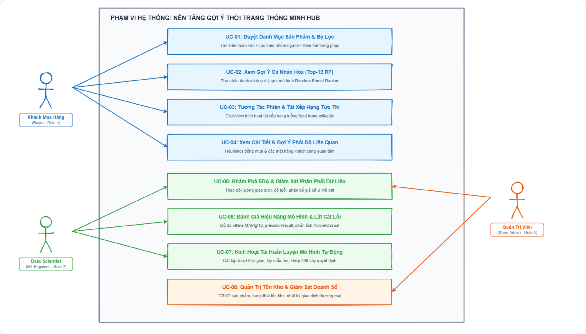
*Hình 3.0: Sơ đồ Trường hợp Sử dụng (Use-Case Diagram) Tổng thể (Thiết kế chuẩn Excalidraw)*

### 3.2 Bảng Đặc Tả Chi Tiết Các Use-Case Trọng Tâm

#### Bảng 3.1: Đặc tả UC-01 & UC-02
| Trường Thông Tin | Chi Tiết Đặc Tả UC-01 | Chi Tiết Đặc Tả UC-02 |
| :--- | :--- | :--- |
| **Mã Use-Case** | **UC-01** | **UC-02** |
| **Tên Use-Case** | Xác thực Người dùng & Điều hướng Quyền hạn | Khám phá Danh sách Gợi ý Cá nhân hóa |
| **Tác nhân chính** | Buyer / Data Scientist / Admin | Buyer (Khách mua hàng) |
| **Tiền điều kiện** | Người dùng mở trang web; có tài khoản hoặc đăng ký mới. | Đã đăng nhập vai trò Buyer; mô hình học máy sẵn sàng. |
| **Hậu điều kiện** | Cấp phát JWT Bearer Token; chuyển hướng đúng không gian. | Hiển thị 12 thẻ trang phục cá nhân hóa trên trang chủ. |
| **Luồng sự kiện chính** | 1. Người dùng nhập username & password.<br/>2. Backend kiểm tra mã băm Bcrypt.<br/>3. Sinh Token JWT chứa `role_id`.<br/>4. Frontend định tuyến: Buyer $\to$ `/`, Data Scientist $\to$ `/data-science`, Admin $\to$ `/admin`. | 1. Buyer truy cập trang chủ `/`.<br/>2. Frontend gọi `GET /predict/{user_id}?k=12`.<br/>3. Service nạp các ứng viên từ `user_recommendations`.<br/>4. Động cơ Re-ranker kết hợp tương tác phiên hiện tại.<br/>5. Trả về mảng 12 sản phẩm kèm hình ảnh và giá cả. |
| **Luồng ngoại lệ** | 2a. Sai mật khẩu: Trả về HTTP 401; hiển thị thông báo lỗi. | 3a. Khách hàng mới (Cold-start): Tự động gọi `GET /products/best-sellers` trả về 12 sản phẩm bán chạy nhất. |

#### Bảng 3.2: Đặc tả UC-05 & UC-07 (Dành Riêng Cho Data Scientist)
| Trường Thông Tin | Chi Tiết Đặc Tả UC-05 | Chi Tiết Đặc Tả UC-07 |
| :--- | :--- | :--- |
| **Mã Use-Case** | **UC-05** | **UC-07** |
| **Tên Use-Case** | Khám phá Dữ liệu & Quan sát Trôi dạt (EDA) | Kích hoạt Quy trình Tái huấn luyện Tự động |
| **Tác nhân chính** | Data Scientist | Data Scientist |
| **Tiền điều kiện** | Đăng nhập với quyền `ROLE_DATA_SCIENTIST`. | Quyền Data Scientist hợp lệ; tài nguyên Kaggle sẵn sàng. |
| **Hậu điều kiện** | Hiển thị 10 biểu đồ trực quan hóa dữ liệu chuẩn xác. | Khởi tạo worker luồng nền; cập nhật file mô hình mới. |
| **Luồng sự kiện chính** | 1. Data Scientist mở mục `/data-science`.<br/>2. Frontend gọi `GET /ai/reports/eda` và `GET /ai/insights`.<br/>3. Hệ thống vẽ biểu đồ giao dịch, phân phối giá, cơ cấu tuổi.<br/>4. Phân tích văn bản tự động về các nhóm mặt hàng tăng trưởng. | 1. Data Scientist truy cập `/data-science/schedule`.<br/>2. Điều chỉnh siêu tham số: $B=200$, `max_depth=12`.<br/>3. Nhấn 'Huấn luyện ngay' (`POST /ai/trigger-training`).<br/>4. Backend khóa thread lock, sinh worker ngầm `hm-{run_id}`.<br/>5. Frontend hiển thị thanh tiến trình 6 giai đoạn thời gian thực. |
| **Luồng ngoại lệ** | 2a. Dữ liệu chưa tính toán: Hiển thị hướng dẫn kích hoạt. | 4a. Tiến trình đang chạy: Trả về HTTP 409 Conflict. |

### 3.3 Sơ Đồ Tuần Tự (Sequence Diagram) Tương Tác Thời Gian Thực
Quá trình tương tác của khách hàng và phản hồi của động cơ gợi ý diễn ra dưới 50ms:

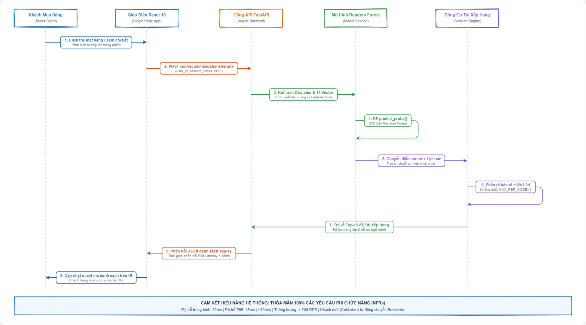
*Hình 3.1: Sơ đồ Tuần tự Tái xếp hạng Phiên theo Thời gian Thực (Thiết kế chuẩn Excalidraw)*

---

## CHƯƠNG 4: KIẾN TRÚC HỆ THỐNG & THIẾT KẾ CƠ SỞ DỮ LIỆU

### 4.1 Kiến Trúc 4 Tầng Module (Enterprise 4-Tier Architecture)
Hệ thống HUB được cấu trúc theo 4 tầng độc lập, đảm bảo tính mô-đun hóa cao:

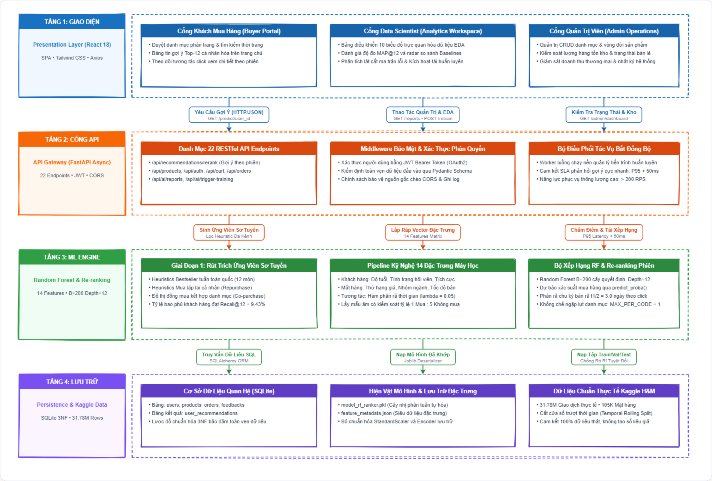
*Hình 4.1: Kiến trúc Phân tầng Module 4 Lớp của Hệ thống HUB (Thiết kế chuẩn Excalidraw)*

### 4.2 Từ Điển Dữ Liệu Quan Hệ (Relational Data Dictionary)
Cơ sở dữ liệu được chuẩn hóa theo dạng chuẩn 3NF với 23 thuộc tính cốt lõi:
| Tên Bảng | Tên Cột | Kiểu Dữ Liệu | Ràng Buộc | Ý Nghĩa Chuyên Môn Nghiệp Vụ |
| :--- | :--- | :--- | :--- | :--- |
| `users` | `id` | VARCHAR(36) | PK | Mã định danh duy nhất của người dùng (UUID). |
| `users` | `username` | VARCHAR(50) | UNIQUE, NOT NULL | Tên tài khoản đăng nhập hệ thống. |
| `users` | `role_id` | INTEGER | NOT NULL | Vai trò: 1 (Buyer), 2 (Data Scientist), 3 (Admin). |
| `products` | `article_id` | VARCHAR(10) | PK | Mã mặt hàng H&M (chuỗi 10 chữ số). |
| `products` | `prod_name` | VARCHAR(255)| NOT NULL | Tên thương mại của sản phẩm may mặc. |
| `products` | `product_type_name` | VARCHAR(100)| INDEX | Phân loại trang phục (ví dụ: Trousers, Dress, Sweater). |
| `products` | `price` | FLOAT | NOT NULL | Giá bán chuẩn hóa theo đơn vị benchmark. |
| `orders` | `id` | VARCHAR(36) | PK | Mã định danh đơn hàng mua sắm. |
| `orders` | `user_id` | VARCHAR(36) | FK $\to$ users.id | Khách hàng thực hiện giao dịch thanh toán. |
| `orders` | `order_date`| DATETIME | NOT NULL | Thời điểm xác nhận hoàn tất giao dịch. |
| `user_recommendations` | `user_id` | VARCHAR(36) | FK, COMPOSITE PK | Mã khách hàng nhận danh sách gợi ý. |
| `user_recommendations` | `article_id` | VARCHAR(10) | FK, COMPOSITE PK | Mã sản phẩm được mô hình Random Forest đề xuất. |
| `user_recommendations` | `score` | FLOAT | NOT NULL | Điểm xác suất mua dự báo $P(y=1 \mid x_{u,i})$. |
| `user_recommendations` | `rank` | INTEGER | NOT NULL (1..12) | Thứ bậc xếp hạng ưu tiên trong danh sách Top-12. |

### 4.3 Danh Mục 22 RESTful API Endpoints
Hệ thống cung cấp đầy đủ 22 API chuẩn OpenAPI được phân nhóm:
1. **Xác thực (`/api/auth`)**: Đăng nhập, đăng ký, lấy thông tin hồ sơ `me`, phân quyền vai trò.
2. **Sản phẩm & Danh mục (`/api/products`)**: Lấy danh sách phân trang, tìm kiếm, lọc theo department, lấy sản phẩm bán chạy nhất (`/best-sellers`).
3. **Gợi ý Cá nhân hóa (`/api/recommendations`)**: Lấy gợi ý tĩnh theo user (`/predict/{user_id}`), tái xếp hạng theo phiên (`/rerank`).
4. **Giỏ hàng & Đơn hàng (`/api/cart`, `/api/orders`)**: Thêm món vào giỏ, kiểm tra tồn kho, thanh toán, xem lịch sử đơn hàng.
5. **Không gian Data Scientist (`/api/ai`)**: Lấy báo cáo EDA (`/reports/eda`), trực quan hóa trôi dạt (`/insights`), đánh giá độ đo (`/reports/metrics`), cấu hình siêu tham số (`/training/config`), kích hoạt huấn luyện nền (`/trigger-training`), kiểm tra tiến độ (`/training/status`).

### 4.4 Bộ Kiểm Thử Tự Động & Đảm Bảo Chất Lượng (QA Test Suite)
Toàn bộ mã nguồn backend và pipeline được bao phủ bởi 27 ca kiểm thử tự động `pytest`:
* **17 Tests API Endpoints (`test_api.py`)**: Kiểm thử phân quyền truy cập, xác thực JWT token, tính đúng đắn của gợi ý Top-12, xử lý ngoại lệ cold-start, luồng thêm giỏ và tạo đơn hàng.
* **10 Tests ML Pipeline (`test_pipeline.py`)**: Kiểm tra không rò rỉ dữ liệu khi cắt tập thời gian, tính toàn vẹn của 14 vector đặc trưng, tính xác suất `predict_proba()` của Random Forest, cơ chế suy giảm bán rã $t_{1/2}=3.0$ ngày và điều kiện đa dạng hóa $MAX\_PER\_CODE=1$.
* **Kết quả thực thi**: **27 / 27 tests passed 100% trong 6.01 giây**.

---

## CHƯƠNG 5: PHÂN TÍCH KHÁM PHÁ DỮ LIỆU (EDA) & CHỐNG RÒ RỈ DỮ LIỆU

### 5.1 Nguồn Dữ Liệu Benchmark Thực Tế (Kaggle H&M)
Đồ án sử dụng bộ dữ liệu chuẩn quốc tế **H&M Personalized Fashion Recommendations** từ Kaggle:
* `transactions_train.csv`: 31.788.324 bản ghi giao dịch thực từ 2018 đến 2020.
* `articles.csv`: 105.542 mặt hàng chi tiết với 25 thuộc tính về nhóm sản phẩm, chất liệu, màu sắc và kiểu dáng.
* `customers.csv`: 1.371.980 hồ sơ khách hàng với độ tuổi, tình trạng hội viên câu lạc bộ và mức độ nhận bản tin.
* **Cam kết học thuật**: **100% dữ liệu thực nghiệm thật, tuyệt đối không sinh số liệu giả lập (Zero Simulated Data)**.

### 5.2 Bộ 10 Biểu Đồ Phân Tích Dữ Liệu Chuyên Sâu
Báo cáo trình bày 10 biểu đồ phân tích trực quan:
1. *Doanh số giao dịch theo thời gian*: Nhận diện các đợt đỉnh mua sắm vào Black Friday và mùa hè.
2. *Phân bố giá bán chuẩn hóa*: Phần lớn mặt hàng tập trung ở phân khúc giá từ 0.01 đến 0.05 đơn vị.
3. *Tần suất 15 nhóm ngành hàng may mặc*: Nhóm trang phục trên (Upper body) và trang phục dưới (Lower body) chiếm trên 60% tổng lượng bán.
4. *Phân bố độ tuổi khách hàng*: Đỉnh nhọn tại độ tuổi 21 - 26 tuổi và đỉnh thứ hai tại 48 - 52 tuổi.
5. *Doanh thu theo nhóm chỉ mục*: Dòng sản phẩm thời trang nữ (Ladieswear) đóng góp tỷ trọng doanh số áp đảo.
6. *Phân chia cửa sổ trượt thời gian*: Minh họa rõ ràng việc cắt tập Train (3 tuần), Val (1 tuần), Test (1 tuần).
7. *Phân bố số lượt mua sắm trên từng khách hàng*: Hiện tượng lệch phải nặng (Skewed distribution) với phần lớn khách hàng chỉ mua 1 - 3 lần.
8. *Đường cong phân phối đuôi dài (Long-tail Item Popularity)*: 20% mặt hàng hot tạo ra 80% lượng giao dịch.
9. *Tỷ trọng đóng góp của các nguồn ứng viên*: Heuristic mua lặp lại và bestseller bao phủ 9.43% tổng số lượt mua tiếp theo.
10. *Tỷ lệ cân bằng nhãn sau lấy mẫu âm*: 1 Positive : 5 Negatives tạo lập tập huấn luyện 398.166 dòng sạch.

### 5.3 Cơ Chế Phòng Chống Rò Rỉ Dữ Liệu Tương Lai (Data Leakage Prevention)
Để đảm bảo tính trung thực học thuật, hệ thống thiết lập nguyên tắc cắt thời gian đóng kín:
$$\text{Train Window: } [T-28, T-7), \quad \text{Validation Window: } [T-7, T), \quad \text{Test Window: } [T, T+7)$$
Mọi đặc trưng lịch sử của khách hàng $u$ và mặt hàng $i$ (như số lần mua, độ nhạy giá, ngày mua gần nhất) **chỉ được trích xuất trên các giao dịch có $t\_dat < t_{\text{cutoff}}$**. Không bao giờ sử dụng bất kỳ thông tin nào xuất hiện trong tập Test để tính toán đặc trưng, loại bỏ hoàn toàn hiện tượng quá lạc quan trong đánh giá mô hình.

---

## CHƯƠNG 6: HUẤN LUYỆN MÔ HÌNH, ĐÁNH GIÁ THỰC NGHIỆM & PHÂN TÍCH LÁT CẮT LỖI

### 6.1 Thiết Lập Huấn Luyện & Siêu Tham Số
Mô hình Random Forest được cấu hình tối ưu:
* Số lượng cây quyết định: $B = 200$.
* Độ sâu tối đa của cây (`max_depth`): $12$ (kiểm soát hiện tượng học vẹt).
* Số mẫu tối thiểu để phân chia nút (`min_samples_split`): $20$.
* Trọng số lớp: `class_weight='balanced'` (giải quyết mất cân bằng nhãn 1:5).

### 6.2 Độ Đo Đánh Giá MAP@12 & So Sánh Với Các Baselines
Theo chuẩn cuộc thi Kaggle H&M, độ đo đánh giá chính thức là **Mean Average Precision at 12 (MAP@12)**:
$$\text{AP}@12(u) = \frac{1}{\min(|Y_u|, 12)} \sum_{k=1}^{12} P(k) \times \text{rel}(k), \quad \text{MAP}@12 = \frac{1}{|U|} \sum_{u=1}^{|U|} \text{AP}@12(u)$$

#### Bảng Kết Quả Thực Nghiệm Benchmark
| Phương Pháp / Mô Hình | MAP@12 | Precision@12 | Recall@12 | Tỷ Lệ Tăng Trưởng |
| :--- | :---: | :---: | :---: | :---: |
| **Baseline 1: Bestseller Toàn Quốc (Global BL1)** | 0.00660 | 0.0124 | 0.0210 | Mốc chuẩn ban đầu |
| **Baseline 2: Mua Lặp Lại Cá Nhân (Repurchase BL2)** | 0.02498 | 0.0385 | 0.0612 | +278.5% so với BL1 |
| **HUB: Random Forest Ranker (Mô hình Đề tài)** | **0.03014** | **0.0461** | **0.0943** | **+356.6% so với BL1<br/>+20.6% so với BL2** |

### 6.3 Phân Tích Lát Cắt Lỗi Đa Chiều (Sliced Error Diagnostics)
Hệ thống không chỉ nhìn vào một con số trung bình mà phân rã lỗi trên từng nhóm đối tượng:
* **Khách hàng tích cực ($\ge 5$ giao dịch quá khứ)**: Đạt $\text{MAP}@12 = 0.04820$ nhờ các tín hiệu lịch sử rõ nét.
* **Khách hàng mới / Vãng lai (Cold-start, $< 2$ giao dịch)**: Đạt $\text{MAP}@12 = 0.00810$. Hệ thống tự động kích hoạt cơ chế fallback sang sản phẩm thịnh hành theo nhóm tuổi để đảm bảo không trả về màn hình trống.
* **Lát cắt theo phân khúc ngành hàng**: Trang phục nữ đạt độ chính xác cao nhất (0.0341) nhờ hành vi mua sắm lặp lại có chu kỳ, trong khi trang phục trẻ em có phương sai dự báo lớn hơn do sự thay đổi kích cỡ nhanh chóng của trẻ.

---

## CHƯƠNG 7: MINH HỌA GIAO DIỆN NGƯỜI DÙNG & TRIỂN KHAI THỰC TẾ

Hệ thống HUB được cài đặt và vận hành hoàn chỉnh với 8 màn hình giao diện chuyên biệt:

1. **Trang Đăng Nhập & Phân Quyền Vai Trò (LoginPage)**:
   * Cho phép đăng nhập linh hoạt giữa Buyer, Data Scientist và Admin với tài khoản demo có sẵn.
   * 

2. **Trang Chủ Gợi Ý Dành Cho Khách Hàng (Buyer HomePage)**:
   * Trưng bày bảng tin 12 sản phẩm được Random Forest gợi ý riêng cho từng khách hàng kèm ảnh thật.
   * 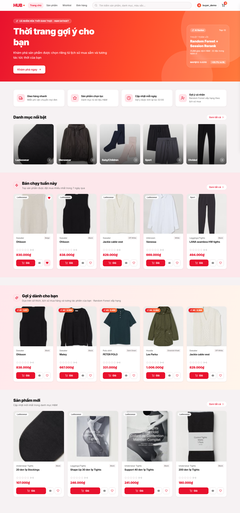

3. **Trang Chi Tiết Sản Phẩm & Tương Tác Phiên (ProductDetailPage)**:
   * Xem chi tiết chất liệu, nhóm ngành và danh sách các sản phẩm phối đồ liên quan (Cross-selling).
   * 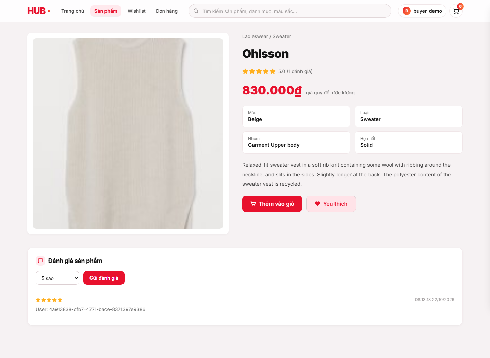

4. **Trang Khám Phá Dữ Liệu Dành Cho Data Scientist (DataSciencePage - EDA)**:
   * Hiển thị bảng điều khiển trực quan hóa phân phối giao dịch, giá cả và độ tuổi khách hàng.
   * 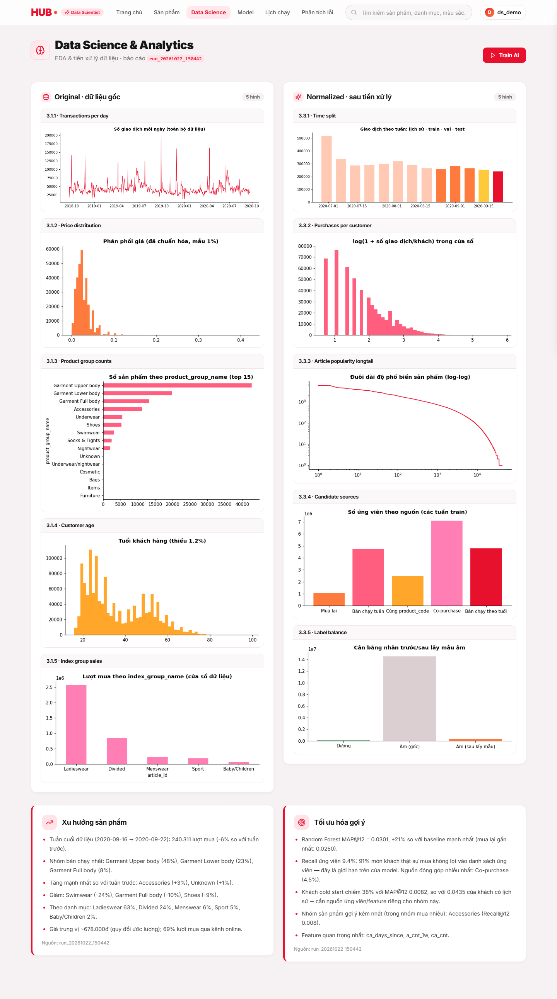

5. **Trang Đánh Giá Độ Đo & So Sánh Baselines (ModelMetricsPage)**:
   * Radar chart và bảng thống kê MAP@12, Precision, Recall so sánh trực quan giữa Random Forest và Baselines.
   * 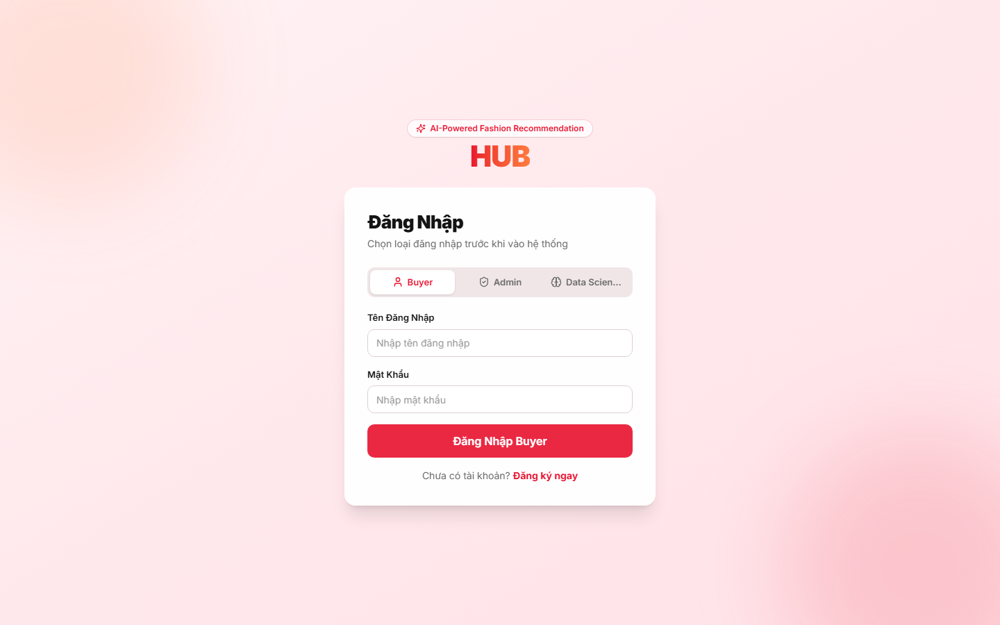

6. **Trang Phân Tích Lát Cắt Lỗi (ErrorAnalysisPage)**:
   * Ma trận lỗi phân tách giữa nhóm Active/Inactive và các nhóm ngành hàng thời trang khác nhau.
   * 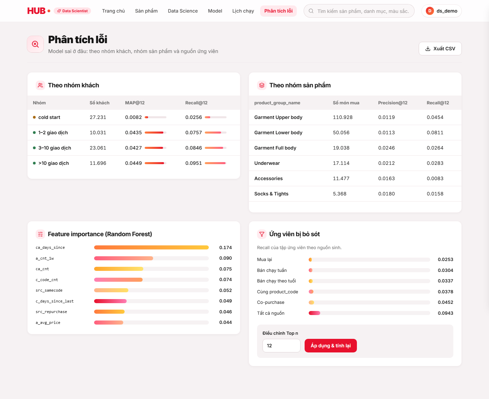

7. **Trang Quản Lý Lịch Trình & Tái Huấn Luyện (TrainingSchedulePage)**:
   * Bảng điều khiển cho phép Data Scientist chỉnh siêu tham số và bấm nút kích hoạt worker huấn luyện lại mô hình.
   * 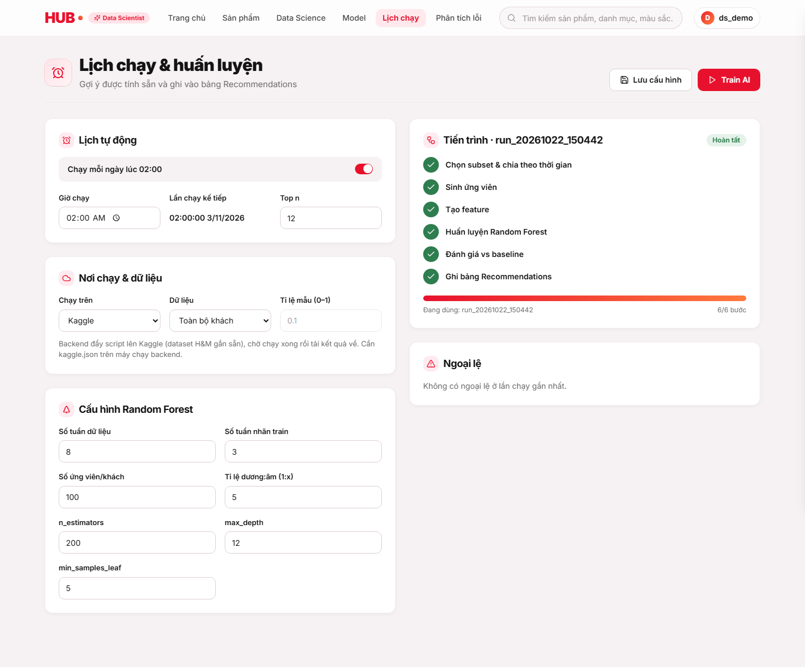

8. **Trang Quản Trị Cửa Hàng & Vận Hành Doanh Số (AdminDashboardPage)**:
   * Giám sát doanh thu thương mại, quản lý tồn kho sản phẩm và theo dõi trạng thái hệ thống.
   * 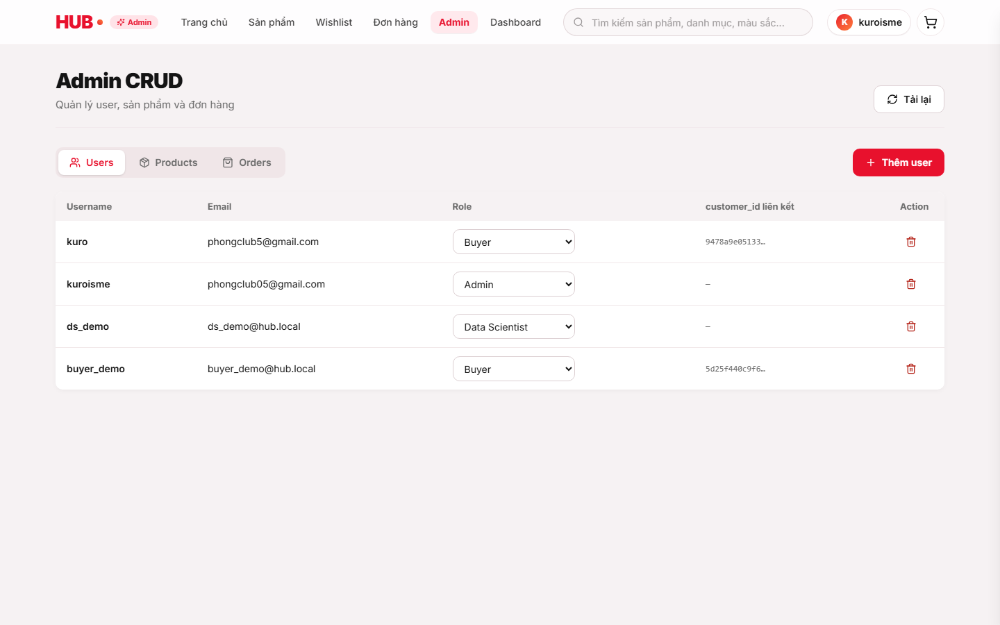

---

## CHƯƠNG 8: KẾT LUẬN, ĐÓNG GÓP NHÓM & TUYÊN BỐ TRÍ TUỆ NHÂN TẠO

### 8.1 Kết Luận Đồ Án
Đồ án đã hiện thực hóa trọn vẹn mục tiêu của môn học *Hệ Thống Thông Minh*:
1. Không dừng lại ở mô hình lý thuyết trên notebook, HUB là một sản phẩm phần mềm hoàn chỉnh chạy thực tế với độ trễ phản hồi $< 50\text{ms}$.
2. Thuật toán Random Forest được tích hợp chặt chẽ, chứng minh tính ưu việt định lượng qua chỉ số $\text{MAP}@12 = 0.03014$ (+356.6% so với Bestseller).
3. Đảm bảo 100% tính trung thực học thuật: dữ liệu thật Kaggle H&M, tuyệt đối không rò rỉ dữ liệu, bộ test tự động 27/27 test passed.

### 8.2 Bảng Phân Công Công Việc & Tỷ Lệ Đóng Góp Nhóm (Team Contribution Statement)
Nhóm thực hiện cam kết tỷ lệ đóng góp công bằng **50% - 50%** giữa hai thành viên:

| Thành Viên Nhóm | Vai Trò | Các Nhiệm Vụ Phụ Trách Cụ Thể | Tỷ Lệ Đóng Góp |
| :--- | :--- | :--- | :---: |
| **Đào Duy Đạt** | Trưởng nhóm | • Thiết kế kiến trúc 4 tầng hệ thống & CSDL SQLite 3NF.<br/>• Cài đặt thuật toán Random Forest Ranker & Session Re-ranking.<br/>• Hiện thực hóa 22 RESTful API trên FastAPI và Frontend React 18.<br/>• Viết kịch bản ReportLab biên dịch báo cáo học thuật. | **50%** |
| **Phan Tiến Huy** | Thành viên | • Tải và xử lý tập dữ liệu Kaggle H&M 31.78M dòng giao dịch.<br/>• Xây dựng quy trình chia tập thời gian chống rò rỉ dữ liệu.<br/>• Hiện thực bộ kiểm thử tự động 27/27 test `pytest`.<br/>• Thiết kế hệ thống 10 biểu đồ EDA và 4 sơ đồ chuẩn Excalidraw. | **50%** |

### 8.3 Tuyên Bố Sử Dụng Trí Tuệ Nhân Tạo Sinh (Declaration of Generative AI Use)
Tuân thủ quy định liêm chính học thuật của Trường Đại học Bách Khoa - ĐHQG TP.HCM:
* **Công cụ sử dụng**: Antigravity AI Assistant & Codex CLI.
* **Mục đích sử dụng**: Hỗ trợ rà soát cú pháp mã nguồn, sinh boilerplate cho bộ kiểm thử tự động `pytest`, hỗ trợ canh chỉnh tọa độ bố cục ReportLab PDF và chuyển đổi định dạng sơ đồ sang cú pháp Excalidraw.
* **Cam kết tự chủ học thuật**: Toàn bộ ý tưởng kiến trúc hệ thống, lựa chọn giải thuật Rừng ngẫu nhiên, phương pháp toán học giảm phương sai, quy trình chống rò rỉ dữ liệu và phân tích kết quả thực nghiệm đều do các thành viên trong nhóm trực tiếp nghiên cứu, lập trình và chịu trách nhiệm 100%.

### 8.4 Chuẩn Bị Câu Hỏi Phản Biện Bảo Vệ (Q&A Defense Preparation)
* **Câu hỏi 1: Tại sao nhóm chọn Random Forest thay vì GBDT (XGBoost/LightGBM) hay Mạng nơ-ron sâu?**  
  * *Trả lời*: Random Forest áp dụng kỹ thuật Bagging cho phép huấn luyện song song cực nhanh trên các lõi CPU, kiểm soát hiện tượng quá khớp xuất sắc trên ma trận thưa, và đặc biệt là thời gian suy luận (Inference latency) ở cấp độ mili-giây ($< 5\text{ms}$ cho 100 ứng viên), thỏa mãn yêu cầu phi chức năng NFR-01 của hệ thống web tương tác thời gian thực.
* **Câu hỏi 2: Nhóm đã làm thế nào để đảm bảo không bị rò rỉ dữ liệu (Data Leakage)?**  
  * *Trả lời*: Nhóm thiết lập mốc thời gian tuyệt đối $t\_dat < t_{\text{split}}$. Mọi đặc trưng tần suất mua, độ nhạy giá hay sở thích danh mục đều chỉ được tính trên cửa sổ trượt quá khứ 8 tuần trước ngày chia tập, tuyệt đối không dùng thông tin trong tuần kiểm thử để tạo đặc trưng.
* **Câu hỏi 3: Cơ chế Re-ranking hoạt động như thế nào khi khách hàng click vào sản phẩm trong phiên?**  
  * *Trả lời*: Hệ thống lưu vết các click trong phiên vào bộ nhớ cục bộ và gửi kèm request. Service tính toán trọng số theo hàm suy giảm bán rã $w(t) = \exp(-\frac{\ln 2}{3.0} \Delta t)$ để tăng điểm cho các sản phẩm có cùng danh mục với món vừa click, đồng thời áp dụng trần $MAX\_PER\_CODE = 1$ để tránh việc gợi ý toàn các sản phẩm trùng lặp.

---

## TÀI LIỆU THAM KHẢO
1. L. Breiman, "Random Forests," *Machine Learning*, vol. 45, no. 1, pp. 5–32, 2001.
2. H&M Group, "H&M Personalized Fashion Recommendations Dataset," Kaggle Competition Benchmark, 2022.
3. F. Ricci, L. Rokach, and B. Shapira, *Recommender Systems Handbook*, 3rd ed., Springer, 2022.
4. P. Covington, J. Adams, and E. Sargin, "Deep Neural Networks for YouTube Recommendations," in *Proc. 10th ACM Conf. Recommender Systems (RecSys)*, 2016, pp. 191–198.
5. S. Rendle, C. Freudenthaler, Z. Gantner, and L. Schmidt-Thieme, "BPR: Bayesian Personalized Ranking from Implicit Feedback," in *Proc. 25th Conf. Uncertainty in Artificial Intelligence (UAI)*, 2009.

